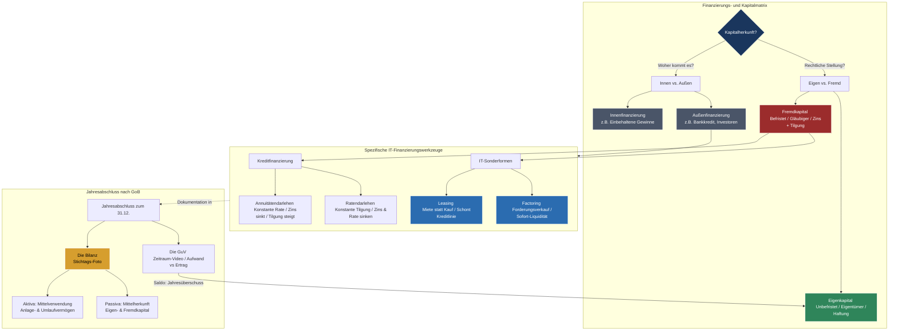

tags: [fisi, ihk, lernsheet]
## 🧭 Navigation & Zusammenhänge
- **Vorausgesetztes Thema:** [[06_Kalkulation, Preisbildung & IT-Stundensatz]]
- **Nächstes Thema:** [[08_Kommunikation, Beratung & CRM]]
- **Verwandte Bausteine:** [[01_Einführung_Allgemeine_BWL]], [[06_Kalkulation, Preisbildung & IT-Stundensatz]]
---

🎯 IHK-Prüfungsrelevanz

> [!IMPORTANT] AP01: Einrichten eines IT-gestützten Arbeitsplatzes
> 
> - **Relevanz:** Niedrig
> - **Fokus:** Kenntnis über die Inventarisierung von Arbeitsplatzkomponenten als Vermögensgegenstände des Unternehmens.

> [!WARNING] AP02: Konzeption, Administration & Netzwerke
> 
> - **Relevanz:** Hoch (Ständiger WiSo- & Handlungsschwerpunkt)
> - **Fokus:** Ein absolutes IHK-Standardthema im wirtschaftlichen Prüfungsteil. Erwartet wird die sichere Unterscheidung von Finanzierungsformen (Eigen- vs. Fremdkapital, Annuitäten- vs. Ratendarlehen), die Beurteilung von Kreditsicherheiten (Sicherungsübereignung, Zession, Bürgschaft) sowie IT-Sonderformen wie IT-Leasing und Factoring. Zudem müssen Kernbegriffe der Bilanz (Anlage- vs. Umlaufvermögen) und der GuV sowie die Kennzahlenberechnung (z.B. Eigenkapitalquote) sitzen.

---

📖 Einfache Erklärung & Praxisbeispiele

Die **Finanzierung** sichert durch die Beschaffung von Kapital das wirtschaftliche Überleben (die Liquidität) eines IT-Betriebs. Während die _Kostenrechnung (KLR)_ intern kalkuliert, dokumentiert die _Buchführung (FiBu)_ lückenlos alle externen Werteflüsse des Unternehmens. Am Jahresende bildet der **Jahresabschluss** das offizielle Ergebnis: Die stichtagsbezogene **Bilanz** zeigt als "Foto" das Vermögen und die Schulden, während die zeitraumbezogene **Gewinn- und Verlustrechnung (GuV)** als "Video" erklärt, wie der Erfolg zustande kam.

Unterthemen & Anschauliche Beispiele:

- **Systematik der Finanzierungsformen:**
    - **Innen- vs. Außenfinanzierung:** Kapital kommt entweder aus einbehaltenen Gewinnen/Abschreibungen des Betriebs oder fließt von außen durch Banken oder Investoren zu.
    - **Eigen- vs. Fremdkapital (EK vs. FK):** EK ist zeitlich unbefristetes Geld der Eigentümer (Haftungskapital). FK sind Schulden bei Gläubigern, die verzinst und getilgt werden müssen. _Vorteil FK:_ Zinsen mindern den Gewinn und sparen Steuern (**Tax Shield**).
- **Klassische Darlehensarten im Vergleich:**
    - **Ratendarlehen (Abzahlungsdarlehen):** Die jährliche Tilgung bleibt konstant. Da die Restschuld sinkt, schrumpfen die Zinsen und damit auch die Gesamtbelastung (Rate) von Jahr zu Jahr.
    - **Annuitätendarlehen:** Die jährliche Rate (Annuität) bleibt über die gesamte Laufzeit absolut identisch. Der Zinsanteil sinkt kontinuierlich, während der Tilgungsanteil im selben Maße steigt. Bietet maximale Planungssicherheit.
    - **Fälligkeitsdarlehen:** Während der Laufzeit werden ausschließlich Zinsen gezahlt. Die Tilgung erfolgt am letzten Tag auf einen Schlag.
- **Sonderformen für IT-Projekte:**
    - **Der Lieferantenkredit & Skonto:** Ein Skontoverzicht ist die teuerste Kostenfalle überhaupt. "2% Skonto bei Zahlung binnen 10 Tagen statt 30 Tage netto" klingt wenig, entspricht hochgerechnet auf das Jahr aber einem extremen Kreditzins von ca. **36% p.a.**.
    - **IT-Leasing (Operate vs. Finance Leasing):** _Operate Leasing_ ist kurzfristig, kündbar und gleicht einer Miete (z.B. Projekt-Hardware). _Finance Leasing_ hat eine unkündbare Grundmietzeit und schont als "Pay as you earn"-Modell das Eigenkapital beim Kauf großer Serverstrukturen.
    - **Factoring:** Der Verkauf offener Kundenforderungen an einen Finanzdienstleister (_Factor_) gegen sofortiges Geld (80-90% der Summe). Es schließt Liquiditätslücken bei langen Zahlungszielen von Großkunden und sichert das Ausfallrisiko ab (**Delkrederefunktion**).
- **Grundsätze ordnungsmäßiger Buchführung (GoB) & Bilanzstruktur:**
    - Nach § 238 HGB gilt für Kaufleute die Buchführungspflicht. Oberste Regeln sind Klarheit, Wahrheit sowie das **Belegprinzip: Keine Buchung ohne Beleg!** Bücher und Belege müssen **10 Jahre** aufbewahrt werden.
    - **Aktiva (Linke Bilanzseite):** Zeigt die _Mittelverwendung_ (Muster: Wo steckt das Geld?). Unterteilt in **Anlagevermögen** (dient dauerhaft, z.B. Serverraum-Gebäude, Patente) und **Umlaufvermögen** (flüssige Mittel, z.B. Warenbestand, Bankguthaben).
    - **Passiva (Rechte Bilanzseite):** Zeigt die _Mittelherkunft_ (Muster: Wer hat das Geld gegeben?). Unterteilt in Eigenkapital und Fremdkapital.

---

📊 Visuelle Darstellung (Mermaid.js)

mermaid

