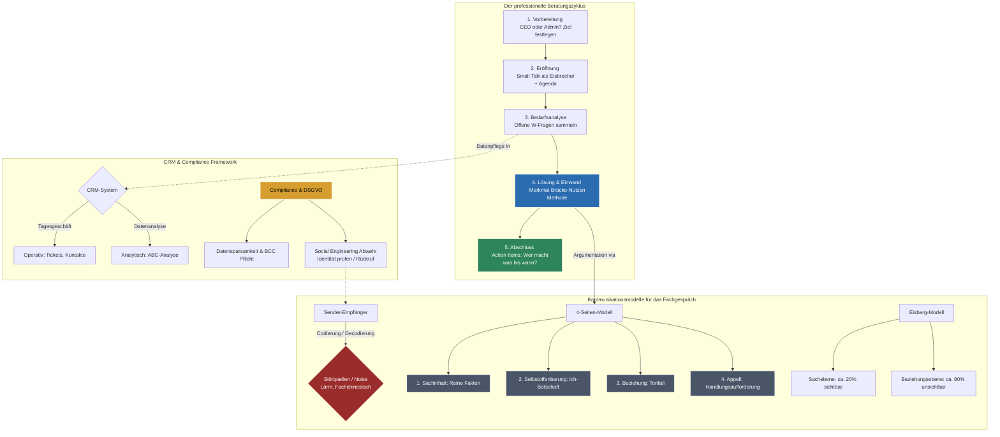

## 🧭 Navigation & Zusammenhänge
- **Vorausgesetztes Thema:** [[07_Finanzierung & Buchführung]]
- **Nächstes Thema:** [[09_Präsentationstechniken & Digitale Werkzeuge]]
- **Verwandte Bausteine:** [[08_Kundenberatung und Marketing in der IT]], [[02_Change Management & IT-Kommunikation]]
---

## 🎯 IHK-Prüfungsrelevanz
> [!IMPORTANT] AP01: Einrichten eines IT-gestützten Arbeitsplatzes
> - **Relevanz:** Niedrig bis Mittel
> - **Fokus:** Grundlagen der kundenorientierten Gesprächsführung bei First-Level-Supportanfragen und die Dokumentation von Ticket-Eingängen.

> [!WARNING] AP02: Konzeption, Administration & Netzwerke
> - **Relevanz:** Extrem Hoch (Prüfungsgarant)
> - **Fokus:** Dieses Thema verknüpft Kernkompetenzen für die schriftliche Prüfung (WiSo/Projektmanagement) mit der mündlichen Abschlussprüfung (Teil 3: Projektpräsentation und Fachgespräch). Die IHK fordert die präzise Anwendung von Kommunikationsmodellen (Schulz von Thun, Watzlawick, Eisberg) zur Deeskalation bei Reklamationen. Zudem sind operative vs. analytische CRM-Systeme, DSGVO-Regeln (BCC, Authentifizierung) und Compliance-Richtlinien im Kundenkontakt feste Prüfungsbestandteile.

---

## 📖 Einfache Erklärung & Praxisbeispiele
Fachinformatiker für Systemintegration arbeiten längst nicht mehr im "stillen Kämmerlein", sondern besetzen eine zentrale **Schnittstellenfunktion**. Sie übersetzen komplexe technische Sachverhalte in verständliche Kundensprache. Professionelle Kommunikation basiert auf bewährten theoretischen Modellen, strukturierten Gesprächsphasen sowie der Nutzung von Customer Relationship Management (CRM) Systemen zur langfristigen Kundenbindung.

### Unterthemen & Anschauliche Beispiele:
- **Die wichtigsten Kommunikationsmodelle im IT-Umfeld:**
  - **Sender-Empfänger-Modell (Shannon & Weaver):** Nachricht wird codiert, via Kanal (E-Mail, Telefon) übermittelt und decodiert. *Erkenntnis:* Fachbegriffe und Lärm wirken als Störquellen (*Noise*). "Gesagt ist nicht gehört, gehört ist nicht verstanden".
  - **4-Seiten-Modell (Schulz von Thun):** Jede Nachricht hat vier Seiten: *Sachinhalt* (Fakten), *Selbstoffenbarung* (Ich-Botschaft), *Beziehungshinweis* (Tonfall) und *Appell* (Handlungsaufforderung).
  - **5 Axiome nach Paul Watzlawick:** 1. Man kann nicht *nicht* kommunizieren. 2. Jede Kommunikation hat Inhalts- und Beziehungsaspekte. 4. Sie läuft digital (Worte) und analog (Körpersprache) ab.
  - **Eisberg-Modell (Sigmund Freud):** Nur ca. 20% sind sichtbar auf der *Sachebene* (Daten, Fakten). Die restlichen 80% liegen unsichtbar auf der *Beziehungsebene* (Ängste, Werte, Gefühle). Konflikte auf der Sachebene sind oft ungelöste Beziehungskonflikte.
- **Die Phasen des Beratungsgesprächs & Nutzenargumentation:**
  - Der Ablauf folgt einer klaren Struktur: **Vorbereitung** (Zielsetzung) $\rightarrow$ **Eröffnung** (Small Talk als Eisbrecher) $\rightarrow$ **Bedarfsanalyse** (mittels offenen W-Fragen: "Wer fragt, der führt!") $\rightarrow$ **Lösungsphase** (Präsentation) $\rightarrow$ **Abschlussphase** (Action Items definieren).
  - 💡 **Praxisbeispiel (Merkmal vs. Nutzen):** Vermeide "Feature Fucking" (reines Aufzählen technischer Details). Nutze stattdessen die Formel *Merkmal + Brücke + Nutzen*. **Schlecht:** "Die Server-Infrastruktur besitzt NVMe-SSDs im RAID-10." **IHK-konform:** "Durch die verbauten Highspeed-Festplatten (*Merkmal*) profitiert Ihr Team von extrem kurzen Ladezeiten (*Vorteil*), sodass Ihre Mitarbeiter morgens ohne Wartezeiten sofort produktiv arbeiten können (*Nutzen*)."
- **Customer Relationship Management (CRM):**
  - **Operatives CRM:** Unterstützt das tägliche Kundengeschäft (Erfassung von Kontakten, Angeboten und Support-Tickets im Ticketsystem).
  - **Analytisches CRM:** Wertet gesammelte Daten systematisch aus (Data Mining, ABC-Kundenbewertung), um Potenziale zu erkennen.
- **Compliance, DSGVO & Social Engineering:**
  - **Compliance (Regeltreue):** Schützt das Unternehmen vor Strafen. Bei Geschenken gilt die interne Wertgrenze (oft max. 35 €) – Transparenz zum Vorgesetzten schützt vor Korruptionsverdacht ("Anfüttern" vermeiden).
  - **DSGVO-Regeln:** Datensparsamkeit einhalten. Bei Rundmails zwingend **BCC** (Blindkopie) statt CC nutzen, um Mailadressen zu schützen. Am Telefon vor einer Datenauskunft immer erst die Identität des Anrufers authentifizieren.
  - **Social Engineering:** Die gezielte Manipulation von Mitarbeitern (z. B. Phishing, CEO-Fraud), um sensible Passwörter oder Daten zu erpressen. *Schutz:* Gesunde Skepsis und Autorisierung über etablierte Rückrufe.

---

## 📊 Visuelle Darstellung (Mermaid.js)

