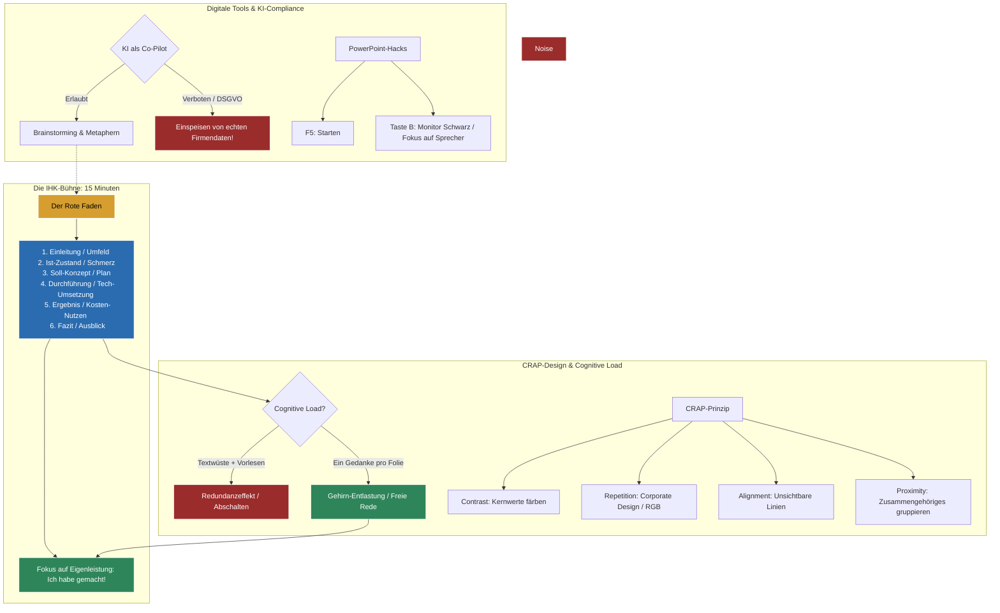

tags: [fisi, ihk, lernsheet]
## 🧭 Navigation & Zusammenhänge
- **Vorausgesetztes Thema:** [[07_Finanzierung & Buchführung]]
- **Nächstes Thema:** [[09_Präsentationstechniken & Digitale Werkzeuge]]
- **Verwandte Bausteine:** [[08_Kundenberatung und Marketing in der IT]], [[02_Change Management & IT-Kommunikation]]
---

🎯 IHK-Prüfungsrelevanz

> [!IMPORTANT] AP01: Einrichten eines IT-gestützten Arbeitsplatzes
> 
> - **Relevanz:** Niedrig
> - **Fokus:** Grundlagen der Medienbereitstellung und Behebung einfacher technischer Pannen bei Präsentations-Hardware (z. B. Beamer-Ausfall).

> [!WARNING] AP02: Konzeption, Administration & Netzwerke
> 
> - **Relevanz:** Absolut Kritisch (Teil 3 der Abschlussprüfung)
> - **Fokus:** Das hier vermittelte Wissen entscheidet direkt über die 50% Präsentations- und Fachgesprächsnote deines Abschlussprojekts. Der Prüfungsausschuss bewertet streng den logischen Aufbau (Roter Faden), die zielgruppengerechte Aufbereitung (Management vs. Techniker), das Vermeiden von "betreutem Lesen" sowie die zwingende Darstellung der kaufmännischen Wirtschaftlichkeit (Kosten-Nutzen-Analyse).

---

📖 Einfache Erklärung & Praxisbeispiele

Eine exzellente fachliche Leistung im Abschlussprojekt verpufft, wenn sie visuell und rhetorisch schlecht verpackt ist. **Struktur schlägt Design**: Das menschliche Gehirn besitzt laut der **Cognitive Load Theory** nur einen begrenzten Arbeitsspeicher. Werden Folien mit Textwüsten überladen, während der Referent spricht, kommt es zum _Redundanzeffekt_ und die Prüfer schalten ab. Zielgerichtetes **Storytelling**, die Anwendung von Design-Prinzipien und der clevere, datenschutzkonforme Einsatz von KI-Tools machen die Präsentation zu deiner Bühne.

Unterthemen & Anschauliche Beispiele:

- **Der perfekte Bauplan (Struktur & Storytelling):**
    - **AIDA-Formel:** _Attention_ (Aufmerksamkeit), _Interest_ (Interesse), _Desire_ (Wunsch), _Action_ (Handlung).
    - 💡 **Praxisbeispiel (AIDA im IT-Support):** **Attention:** "Jeden Tag verlieren wir 30 Minuten durch langsame Logins." → **Interest:** "Das kostet das Unternehmen 50.000 € im Jahr." → **Desire:** "Mit Single-Sign-On (SSO) wäre das Problem gelöst." → **Action:** "Lassen Sie uns das SSO-Modul einführen."
    - **Die Heldenreise im IT-Projekt:** Der _Held_ ist immer der Kunde/Anwender (nicht du!). Das _Monster_ ist das IT-Problem (Papierchaos, Downtime). Du bist der _Mentor_, der dem Helden die _Waffe_ (deine technische Lösung) an die Hand gibt.
    - **Der klassische IHK-Aufbau:** 1. Einleitung/Projektumfeld → 2. Ist-Zustand (Problem/Schmerz) → 3. Soll-Konzept (Plan) → 4. Durchführung (technische Umsetzung) → 5. Ergebnis & Kosten/Nutzen → 6. Fazit & Ausblick.
- **Visuelle Gestaltung nach dem CRAP-Prinzip:**
    - **C**ontrast (Kontrast): Wichtige Kernelemente farbig hervorheben.
    - **R**epetition (Wiederholung): Einen einheitlichen Stil wahren (Corporate Design).
    - **A**lignment (Ausrichtung): Elemente an unsichtbaren Linien sauber ausrichten.
    - **P**roximity (Nähe): Zusammengehörige IT-Komponenten (z. B. im Netzplan) gruppieren.
    - _Typografie-Regel:_ Nutzen Sie auf Bildschirmen ausschließlich **serifenlose Schriften** (z. B. Roboto, Segoe UI) mit einer **Mindestgröße von 18pt bis 24pt** und vermeiden Sie unleserliche REINE GROSSBUCHSTABEN.
- **KI-Support im Projektalltag (Pilot & Co-Pilot):**
    - Large Language Models (ChatGPT, Claude) eignen sich hervorragend als Brainstorming-Partner, zum Finden von Metaphern oder zum Generieren von Sprechernotizen. Tools wie _Gamma.app_ helfen bei ersten Folienentwürfen.
    - ⚠️ **WICHTIGE COMPLIANCE-REGEL:** Du bist der Pilot, die KI ist nur der Co-Pilot. **Niemals echte Firmen- oder personenbezogene Daten in öffentliche KIs einspeisen (Datenschutz)!** Führe immer einen harten Faktencheck durch, da KIs halluzinieren können.
- **Die IHK-Präsentation souverän meistern:**
    - **"ICH" statt "WIR":** Der Prüfungsausschuss bewertet _deine_ persönliche Leistung. Sage im Hauptteil nicht "Wir haben den Server installiert", sondern **"Ich habe den Server konfiguriert"**.
    - **Lampenfieber & Pannen-Management:** Lerne die ersten drei Sätze komplett auswendig. Drücke im Vortrag die Taste **"B"** für einen schwarzen Bildschirm, um den Fokus komplett auf dich zu lenken. Sollte der Beamer streiken, ziehst du ruhig vorbereitete Handouts aus der Tasche – das beweist echte Krisenkompetenz!

---

📊 Visuelle Darstellung (Mermaid.js)

mermaid

