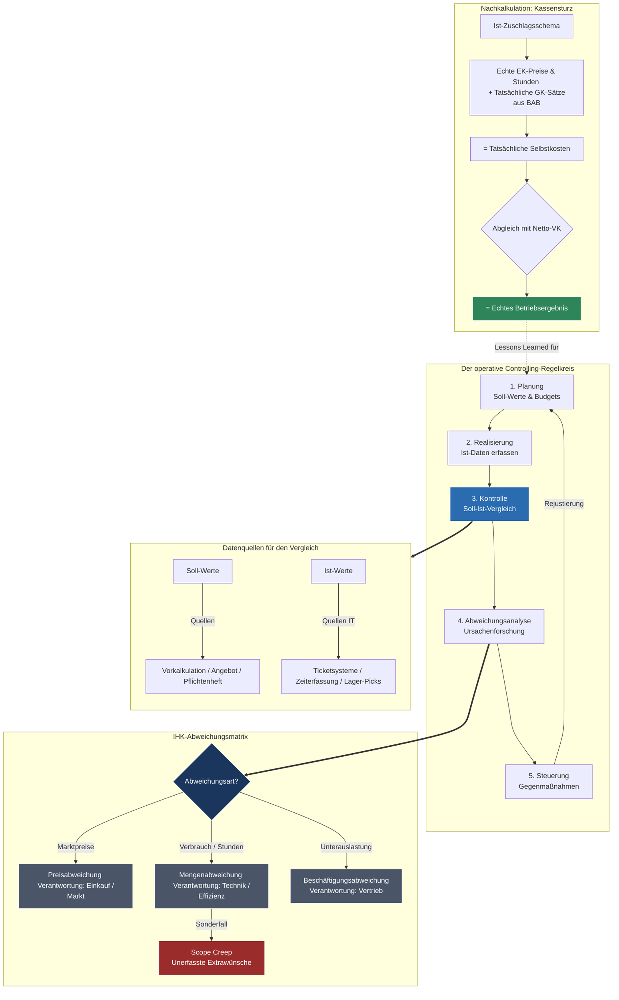

tags: [fisi, ihk, lernsheet]
## 🧭 Navigation & Zusammenhänge
- **Vorausgesetztes Thema:** [[09_Präsentationstechniken & Digitale Werkzeuge]]
- **Nächstes Thema:** [[11_Das große Repetitorium (Big Picture & IHK-Klausurvorbereitung)]]
- **Verwandte Bausteine:** [[07_Controlling]], [[12_Kennzahlen & Soll-Ist-Vergleich im IT-Betrieb]]
---

🎯 IHK-Prüfungsrelevanz

> [!IMPORTANT] AP01: Einrichten eines IT-gestützten Arbeitsplatzes
> 
> - **Relevanz:** Niedrig
> - **Fokus:** Disziplin bei der Datenerfassung (z. B. korrekte Buchung von Ticketzeiten und Dokumentation von Hardware-Entnahmen).

> [!WARNING] AP02: Konzeption, Administration & Netzwerke
> 
> - **Relevanz:** Extrem Hoch (Kaufmännischer Prüfungsschwerpunkt)
> - **Fokus:** Ein absoluter Pflichtbaustein für die wirtschaftlichen Handlungsschritte. Die IHK fordert regelmäßig die Durchführung und Interpretation eines **Soll-Ist-Vergleichs**, die rechnerische Durchführung einer **Nachkalkulation** auf Basis des Zuschlagsschemas sowie das Erkennen und Kategorisieren von Projektabweichungen (Preis-, Mengen- und Beschäftigungsabweichung). Auch Phänomene wie **Scope Creep** sind feste Prüfungsbestandteile.

---

📖 Einfache Erklärung & Praxisbeispiele

Das weit verbreitete Missverständnis lautet, Controlling bedeute reine „Kontrolle“. Tatsächlich leitet es sich vom englischen Wort _„to control“_ ab und bedeutet **steuern**. Der Controller agiert im IT-Unternehmen nicht als Polizist, sondern als Lotse oder Navigator für die Projektleitung. Da IT-Projekte dazu neigen, teurer zu werden als geplant, bildet das Controlling das wirtschaftliche Navigationssystem, um einen Blindflug ohne Zahlen zu verhindern.

Unterthemen & Anschauliche Beispiele:

- **Strategisches vs. Operatives Controlling:**
    - **Strategisch:** Langfristiger Horizont (**3 bis 5 Jahre**). Zentrale Frage: _„Machen wir die richtigen Dinge?“_ (**Effektivität**). _Beispiel:_ Setzen wir strategisch auf den Ausbau von KI- oder Cloud-Infrastrukturen?
    - **Operativ:** Kurz- bis mittelfristiger Horizont (**Monat, Quartal, Jahr**). Zentrale Frage: _„Machen wir die Dinge richtig?“_ (**Effizienz**). _Beispiel:_ Bleiben wir beim laufenden Projekt im geplanten Budget?
- **Der Regelkreis des Controllings:**  
    Controlling ist ein kontinuierlicher Zyklus:
    1. **Planung (Soll):** Budget- und Zielfestlegung via Vorkalkulation.
    2. **Realisierung (Ist):** Datenerfassung von echten Stunden und Material während der Umsetzung.
    3. **Kontrolle:** Periodische Gegenüberstellung von Soll- und Ist-Werten an Meilensteinen.
    4. **Abweichungsanalyse:** Ursachenforschung, warum Zahlen vom Plan abweichen.
    5. **Steuerung:** Einleiten von kaufmännischen oder technischen Gegenmaßnahmen.
- **Die drei großen Abweichungsarten:**
    - **Preisabweichung:** Marktpreise haben sich verändert (z. B. teurere SSDs durch weltweiten Chipmangel). _Maßnahme:_ Angebote befristen.
    - **Mengenabweichung:** Es wurde mehr Material oder Zeit verbraucht als geplant (z. B. 120 statt 100 Technikerstunden durch Installationsprobleme). _Maßnahme:_ Prozesse straffen, Nachschulungen.
    - **Beschäftigungsabweichung:** Die Abteilung oder das Systemhaus ist nicht ausgelastet, wodurch unproduktive Leerkosten entstehen. _Maßnahme:_ Vertrieb stärken.
- **Sonderfall „Scope Creep“:**  
    Der Kunde wünscht während der Durchführung „nur mal kurz“ eine kleine Extraleistung. Die Technik erbringt diese unentgeltlich, ohne dass sie im System erfasst oder abgerechnet wird. Dies führt zu einer massiven Mengenabweichung ohne zusätzlichen Umsatzerlös. _Lösung:_ Ein konsequentes Change Management und das Stellen von offiziellen Change Requests.
- **Die Nachkalkulation:**  
    Der kaufmännische Kassensturz nach Projektende. Hierbei wird das bekannte Zuschlagsschema (Tag 6) erneut durchlaufen, jedoch werden alle **Plan-Werte durch reale Ist-Werte** (echte Einkaufspreise, Stundenzettel, tatsächliche Gemeinkostensätze aus dem BAB) ersetzt. Der Abgleich der tatsächlichen Selbstkosten mit dem Netto-Verkaufspreis ergibt das exakte **Betriebsergebnis** (Gewinn oder Verlust) des Auftrags.

---

📊 Visuelle Darstellung (Mermaid.js)

