tags: [fisi, ihk, repetitorium, mindmap]
## 🧭 Navigation & Zusammenhänge
- **Vorausgesetztes Thema:** [[10_Controlling im IT-Projekt (Soll-Ist-Vergleich & Nachkalkulation)]]
- **Nächstes Thema:** [[01_Technical English IT Infrastructure & Networking]] *(Übergang zu Modul 09)*
- **Verwandte Bausteine:** [[01_Einführung_Allgemeine_BWL]], [[07_Zusammenfassung Fachbezogenes Rechnen & Digitaltechnik]]
---

🎯 IHK-Prüfungsrelevanz

> [!WARNING] AP02: Wirtschafts- und Sozialkunde (WiSo) & Projektmanagement
> 
> - **Relevanz:** Höchste (Das "Big Picture" für den kaufmännischen Prüfungserfolg)
> - **Fokus:** Die IHK prüft selten isolierte Begriffe. In den ganzheitlichen Aufgaben und im WiSo-Teil musst du Zusammenhänge blitzschnell herstellen können. Dieses Repetitorium dient als kognitiver Anker, um rechtliche Störungen (Verzug/Mangel), finanzielle Kennzahlen (BAB/Kalkulation/Kredite) und organisatorische Frameworks (PDCA/Change) fehlerfrei miteinander zu verknüpfen.

---

📖 Das "Big Picture" des Prüfungsstoffes

Ein IT-Projekt durchläuft verschiedene Phasen, in denen kaufmännische, rechtliche und organisatorische Werkzeuge ineinandergreifen:

1. **Anbahnung & Kalkulation:** Das Lastenheft/Pflichtenheft bildet die rechtliche Basis. Der IT-Stundensatz (auf Basis von ca. **1.200 fakturierbaren Stunden/Jahr**) und das Zuschlagsschema der **Kostenträgerrechnung** liefern die **Vorkalkulation** für das Kundenangebot.
2. **Rechtlicher Rahmen & Vollmachten:** Verträge werden geschlossen. Der Projektleiter benötigt eine **Handlungsvollmacht** (§ 54 HGB für branchenübliche Geschäfte), während Geschäftsführer oder Prokuristen (**Prokura** § 48 HGB mit Eintragung im Handelsregister) weitreichende Geschäfte zeichnen. Bei Verzögerungen greift das Recht des **Verzugs** (Fälligkeit + Nichtleistung + Mahnung – außer bei kalendermäßig bestimmten Fixterminen).
3. **Durchführung & Change Management:** IT-Projekte verändern Abläufe. Mittels **PDCA-Zyklus** (Plan-Do-Check-Act) wird die Qualität gesichert. Widerstände im Team (aktiv/passiv) werden durch strukturiertes **Change Management** und frühzeitige Einbindung des Betriebsrats aufgefangen.
4. **Projekt-Überwachung (Controlling):** An Meilensteinen erfolgt der **Soll-Ist-Vergleich**. Daten aus Ticketsystemen (Ist) werden mit der Vorkalkulation (Soll) abgeglichen. Bei Abweichungen wird nachgesteuert, um **Scope Creep** (unerfasste Extrawünsche des Kunden) zu verhindern.
5. **Abschluss, Abnahme & Nachkalkulation:** Die **Abnahme (§ 640 BGB)** ist der _Big Bang_ des Werkvertrags – sie bewirkt die Fälligkeit der Vergütung, den Gefahrübergang und die **Beweislastumkehr**. Abschließend klärt die **Nachkalkulation** mittels realer Ist-Werte das tatsächliche Betriebsergebnis.

---

📊 Das IHK-Gesamtnetzwerk (Mermaid.js)

```mermaid

flowchart TD
    %% 1. RECHTLICHER RAHMEN
    subgraph RECHT [1. Recht & Leistungsstörungen]
        direction TB
        V_Art{Vertragsart?} -->|Zeit gegen Geld| DV[Dienstvertrag § 611 BGB <br> Support-Hotline / Beratung]
        V_Art -->|Erfolg gegen Geld| WV[Werkvertrag § 631 BGB <br> Software-Erstellung / Installation]
        
        WV --> AB[Abnahme § 640 BGB <br> Fälligkeit, Gefahrübergang, Beweislastumkehr]
        
        Stoerung{Leistungsstörung?} -->|Nichtleistung| VZ[Verzug § 286 BGB <br> Mahnung nötig außer bei Fixtermin]
        Stoerung -->|Mangel| SM[Sachmangel § 434 BGB <br> 1. Nacherfüllung / 2. Rücktritt, Minderung]
    end

    %% 2. ORGANISATION & ORG
    subgraph ORG [2. Organisation & Prozesse]
        direction TB
        VM[Vollmachten] --> HV[Handlungsvollmacht § 54 HGB <br> Branchenüblich / i.V. oder i.A.]
        VM --> PR[Prokura § 48 HGB <br> Handelsregister / ppa.]
        
        KVP[Qualität / KVP] --> PDCA[PDCA-Zyklus <br> Plan -> Do -> Check -> Act]
        
        CM[Change Management] --> WK[Veränderungskurve <br> Schock -> Tal der Tränen -> Erfolg]
        CM --> BR[Betriebsrat & Stakeholder <br> Frühzeitig einbinden!]
    end

    %% 3. RECHNUNGSWESEN & KALKULATION
    subgraph RECH [3. Rechnungswesen & Kalkulation]
        direction TB
        RW{Ebene?} -->|Extern| FiBu[Finanzbuchhaltung <br> Aufwand / Ertrag -> Bilanz & GuV]
        RW -->|Intern| KLR[Kosten- & Leistungsrechnung <br> Kosten / Leistungen -> Kassensturz]
        
        Abgrenz[Abgrenzung] --> NA[Neutrale Aufwendungen <br> Betriebsfremd, periodenfremd]
        Abgrenz --> KK[Kalkulatorische Kosten <br> Unternehmerlohn, kalk. Abschreibung]
        
        K_Stufe[KLR-3-Stufen] --> K_Art[Kostenarten: Fix vs. Variabel / Einzel vs. Gemein]
        K_Stufe --> K_Stelle[Kostenstellen: BAB / Verteilung Gemeinkosten]
        K_Stufe --> K_Traeger[Kostenträger: Zuschlagsschema / Vorkalkulation]
        
        K_Traeger --> ST[IT-Stundensatz <br> Basis: ca. 1200 fakturierbare Std.]
    end

    %% 4. FINANZIERUNG & CONTROLLING
    subgraph CONTROL [4. Finanzierung & Controlling]
        direction TB
        FIN[Finanzierungsarten] --> Außen[Außen: Kredit, Leasing, Factoring]
        FIN --> Innen[Innen: Gewinne, Abschreibungsrückfluss]
        
        CON[Controlling-Regelkreis] --> S_I[Soll-Ist-Vergleich <br> Regelmäßig an Meilensteinen]
        S_I --> AW[Abweichungsanalyse <br> Preis- vs. Mengenabweichung]
        S_I --> NK[Nachkalkulation <br> Nach Projektende / Ist-Kosten]
        
        AW -->|Gefahr| SC[Scope Creep <br> Durch Change Management blocken]
    end

    %% GLOBALE VERNETZUNGEN (Das Big Picture)
    WV ==>|Erfordert zwingend| AB
    K_Traeger ==>|Liefert Soll-Basis für| S_I
    FiBu -.->|Liefert Belege & Ist-Daten für| R
    HV -.->|Darf Verträge zeichnen im Rahmen von| WV
    PDCA -.->|Check-Phase beinhaltet| S_I
    NK ==>|Korrigiert künftige| K_Traeger

    %% Styling
    style WV fill:#1a365d,stroke:#fff,stroke-width:1px,color:#fff
    style AB fill:#9b2c2c,stroke:#fff,stroke-width:2px,color:#fff
    style PR fill:#4a5568,stroke:#fff,stroke-width:1px,color:#fff
    style PDCA fill:#2b6cb0,stroke:#fff,stroke-width:1px,color:#fff
    style S_I fill:#d69e2e,stroke:#fff,stroke-width:2px,color:#000
    style SC fill:#9b2c2c,stroke:#fff,stroke-width:1px,color:#fff
    style NK fill:#2f855a,stroke:#fff,stroke-width:2px,color:#fff
```

---

🧠 Express-Prüfungscheck (IHK-Direktfragen auflösen)

📋 Rechtlicher IHK-Check:

1. **Darf ein Kunde die Abnahme wegen eines GUI-Tippfehlers verweigern?**
    - **Nein.** Nach § 640 BGB berechtigen nur _wesentliche Mängel_ zur Verweigerung. Ein Tippfehler ist ein _unwesentlicher Mangel_ – die Abnahme muss _unter Vorbehalt_ erfolgen.
2. **Was unterscheidet den Dienstvertrag vom Werkvertrag fundamental?**
    - Beim Dienstvertrag schuldet man nur das _schuldrechtliche Bemühen_ (Zeit gegen Geld, z.B. Support-Hotline). Beim Werkvertrag schuldet man zwingend einen _konkreten, mängelfreien Erfolg_ (Erfolg gegen Geld, z.B. Software-Erstellung) inklusive Abnahmepflicht.
3. **Wann befindet sich ein Schuldner ohne Mahnung in Verzug?**
    - Wenn der Leistungszeitpunkt _kalendermäßig bestimmt_ ist (Fixtermin) oder der Schuldner die Erfüllung ernsthaft und endgültig verweigert.

🧮 Rechnerischer IHK-Check:

1. **Was passiert mit dem IT-Stundensatz, wenn die Auslastung sinkt?**
    - Er **steigt exponentiell**. Da die fixen Bereitschaftskosten gleich bleiben, aber durch weniger produktive (fakturierbare) Stunden geteilt werden, schlägt die _Fixkostenprogression_ negativ durch.
2. **Warum nutzen wir in der KLR die kalkulatorische Abschreibung?**
    - Die FiBu schreibt gesetzlich gedeckelt vom historischen Anschaffungswert ab. Die KLR nutzt den (oft höheren) **Wiederbeschaffungswert**, um die _Substanzerhaltung_ des Unternehmens bei der Preiskalkulation künftiger Angebote abzusichern.
3. **Was ist der kaufmännische Unterschied zwischen Rabatt und Skonto?**
    - Ein **Rabatt** ist ein sofortiger Preisnachlass (Menge/Treue) und dient als _Kaufanreiz_. Ein **Skonto** ist ein optionaler Nachlass bei schneller Zahlung innerhalb einer Frist und dient als _Zahlanreiz_ zur schnellen Liquiditätsbeschaffung.