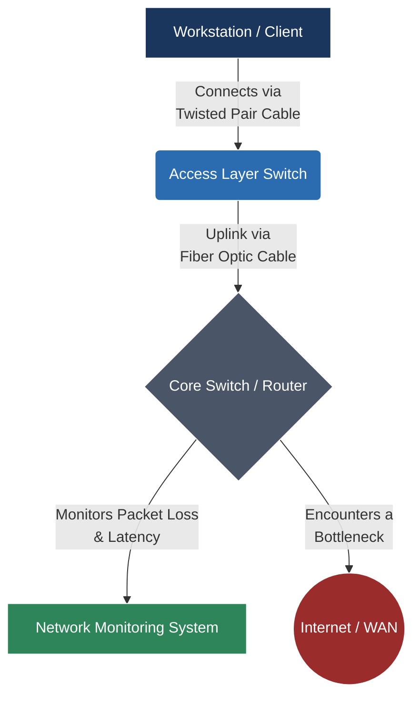

## 🧭 Navigation & Zusammenhänge
- **Vorausgesetztes Thema:** [[11_Das große Repetitorium (Big Picture & IHK-Klausurvorbereitung)]]
- **Nächstes Thema:** [[02_Technical English Software Development & Databases]]
- **Verwandte Bausteine:** [[01_Internet-Infrastruktur, Normen & Ressourcenverwaltung]], [[02_Das ISO, OSI-Referenzmodell & TCP, IP-Schichtenmodell]]
---

## 🎯 IHK-Prüfungsrelevanz
> [!IMPORTANT] AP01: Einrichten eines IT-gestützten Arbeitsplatzes
> - **Relevanz:** Hoch
> - **Fokus:** Verstehen von englischen Datenblättern, Spezifikationen von Client-Hardware (CPU, RAM, Storage) und Verkabelungstypen (Copper vs. Fiber).

> [!WARNING] AP02: Konzeption, Administration & Netzwerke
> - **Relevanz:** Sehr Hoch
> - **Fokus:** Analyse englischer Fehlermeldungen (Troubleshooting), Fachbegriffe zu Routing/Switching (VLAN, STP, OSPF) und das Übersetzen von Kundenanforderungen in technische Setups.

---

## 📖 Einfache Erklärung & Praxisbeispiele
Im IHK-Englisch geht es vor allem darum, **Fachtexte sinngemäß zu verstehen**, Anleitungen umzusetzen und Fehlermeldungen korrekt zu deuten. Du musst Vokabeln kennen, die im Deutschen oft anders genutzt oder eingedeutscht werden.

### Unterthemen & Anschauliche Beispiele:

- **Network Hardware & Wiring:** Die korrekte Benennung von Komponenten und Kabeln im Englischen.
  - *to deploy:* Bereitstellen / Implementieren.
  - *patch panel / termination panel:* Rangierfeld.
  - *twisted pair / fiber optic:* Kupfer- vs. Glasfaserkabel.
  - 💡 **Praxisbeispiel:** In der AP01 liegt ein englisches Angebot für eine strukturierte Verkabelung vor: *"Deploy Category 6A shielded twisted-pair cables for all workstations."* (Nutze geschirmte Cat.6A-Kupferkabel für alle Arbeitsplätze).

- **Troubleshooting & Network States:** Zustände beschreiben und Fehler systematisch eingrenzen.
  - *latency / jitter / packet loss:* Verzögerung / Signalschwankung / Paketverlust.
  - *bottleneck:* Engpass (z. B. eine überlastete 1-Gbit/s-Uplink-Leitung).
  - *intermittent connectivity:* Unregelmäßige/unterbrochene Verbindung.
  - 💡 **Praxisbeispiel:** Ein englischer Syslog-Eintrag in der AP02 meldet: *"Interface GigabitEthernet0/1: Intermittent link flaps detected."* (Die Verbindung bricht immer wieder kurz ab und baut sich neu auf – Kabel- oder Portdefekt).

- **Key Technical Verbs (Die wichtigsten Aktionsverben):**
  - *to configure / to maintain:* Konfigurieren / Instandhalten.
  - *to troubleshoot / to resolve:* Fehler suchen / Lösen.
  - *to grant / to revoke permissions:* Rechte gewähren / entziehen.

---

## 📊 Visuelle Darstellung (Mermaid.js)

---

## 🧠 IHK-Vokabeltrainer (Die wichtigsten "False Friends" & Phrasen)

| Deutscher Begriff | Korrekter englischer Begriff | Achtung: Typischer Fehler (Falsch!) |
| :--- | :--- | :--- |
| **Beamer / Projektor** | Projector | Beamer *(bedeutet im Englischen umgangssprachlich BMW)* |
| **Aktuell / Derzeit** | Current / Currently | Actual *(bedeutet "tatsächlich/wirklich")* |
| **Steuerung / Kontrolle** | Control | Control *(bedeutet regeln, NICHT überwachen / checken)* |
| **Protokoll (Meeting)** | Minutes (of the meeting) | Protocol *(bedeutet Netzwerkprotokoll oder Verhaltensregel)* |
