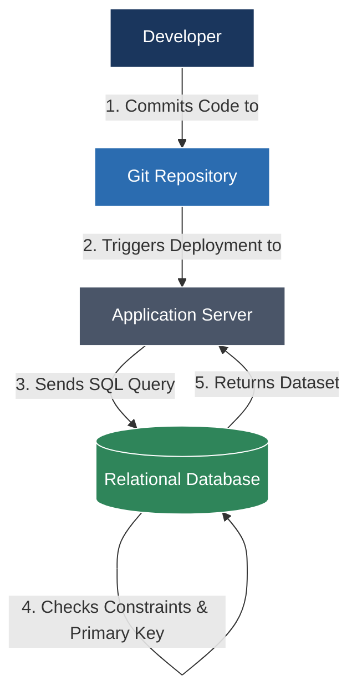

## 🧭 Navigation & Zusammenhänge
- **Vorausgesetztes Thema:** [[01_Technical English IT Infrastructure & Networking]]
- **Nächstes Thema:** [[03_Technical English Technical Customer Support & Incident Management]]
- **Verwandte Bausteine:** [[01_Einführung in die Programmierung & Logikgrundlagen]], [[01_Datenbankmodelle & Schichtenmodell der Erkenntnis]]
---

## 🎯 IHK-Prüfungsrelevanz
> [!IMPORTANT] AP01: Einrichten eines IT-gestützten Arbeitsplatzes
> - **Relevanz:** Mittel bis Hoch
> - **Fokus:** Englische Begrifflichkeiten in Algorithmen (Loops, Conditions) und grundlegende Skriptbefehle (Bash/PowerShell) zur Automatisierung von Client-Setups.

> [!WARNING] AP02: Konzeption, Administration & Netzwerke
> - **Relevanz:** Hoch
> - **Fokus:** Verstehen von englischsprachigen Fehlermeldungen bei Datenbank-Queries, logische Operatoren, ERM-Begriffe (Primary Key, Foreign Key) und Versionierung (Git).

---

## 📖 Einfache Erklärung & Praxisbeispiele
Auch als Systemintegrator musst du Code lesen und Datenbanken administrieren können. Die IHK nutzt in Prüfungen oft englische Begriffe für Programmierkonzepte, da die gesamte Entwicklungswelt englischsprachig ist.

### Unterthemen & Anschauliche Beispiele:

- **Database Terminology (Relational Databases):** Die Struktur von SQL und ER-Modellen.
  - *to query:* Abfragen (eine Datenbank abfragen).
  - *constraints:* Einschränkungen / Bedingungen (z. B. NOT NULL, UNIQUE).
  - *primary key / foreign key:* Primärschlüssel / Fremdschlüssel.
  - *redundancy / data integrity:* Redundanz / Datenintegrität.
  - 💡 **Praxisbeispiel:** In der AP02 musst du eine Fehlermeldung analysieren: *"Foreign key constraint fails on table 'orders'."* (Die Datenintegrität wurde verletzt, weil versucht wurde, eine Bestellung für einen Kunden anzulegen, dessen ID in der Kundentabelle nicht existiert).

- **Programming & Logic (Pseudocode & Skripte):** Kontrollstrukturen richtig deuten.
  - *statement / expression:* Anweisung / Ausdruck.
  - *conditional statement:* Bedingte Anweisung (If-Else).
  - *loop (while / for):* Schleife (wiederholte Ausführung).
  - *to execute / to compile:* Ausführen / Kompilieren (Quellcode in Maschinencode übersetzen).
  - 💡 **Praxisbeispiel:** Ein englisches PowerShell-Skript zur Benutzeranlage enthält die Zeile: *"If execution policy is restricted, the script will terminate."* (Wenn die Ausführungsrichtlinie eingeschränkt ist, bricht das Skript ab).

- **Version Control (Git-Grundlagen):**
  - *repository:* Das Projektverzeichnis (Speicherort).
  - *to commit / to push:* Änderungen lokal speichern / auf den Server hochladen.
  - *to merge / branch:* Zusammenführen / Entwicklungszweig.

---

## 📊 Visuelle Darstellung (Mermaid.js)

---

## 🧠 IHK-Vokabeltrainer (Die wichtigsten Software-Begriffe)

| Englischer Fachbegriff | Deutsche Bedeutung | Typischer IHK-Kontext |
| :--- | :--- | :--- |
| **Legacy system** | Altsystem / Veraltetes System | "The client needs to migrate data from a legacy system..." |
| **To deprecate** | Missbilligen / Veralten lassen | "This function is deprecated and will be removed in v3.0." |
| **Maintainability** | Wartbarkeit (von Code/Systemen) | "Clean code improves the maintainability of the software." |
| **Variables / Constants** | Variablen / Konstanten | Speicherplätze für veränderliche oder feste Werte. |
