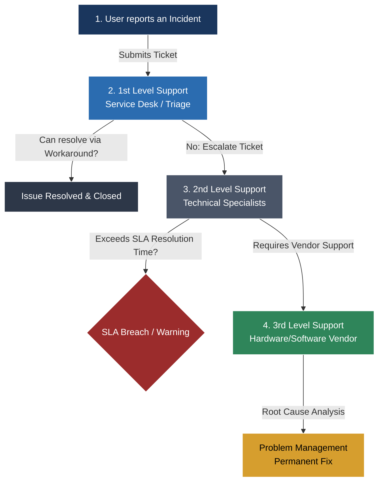

## 🧭 Navigation & Zusammenhänge
- **Vorausgesetztes Thema:** [[02_Technical English Software Development & Databases]]
- **Nächstes Thema:** [[04_Technical English Cyber Security & Data Privacy]]
- **Verwandte Bausteine:** [[08_Kundenberatung und Marketing in der IT]], [[08_Kommunikation, Beratung & CRM]]
---

## 🎯 IHK-Prüfungsrelevanz
> [!IMPORTANT] AP01: Einrichten eines IT-gestützten Arbeitsplatzes
> - **Relevanz:** Hoch
> - **Fokus:** Verstehen von englischen Support-Tickets, Priorisierung von Incidents (Störungen) am Arbeitsplatz und grundlegende schriftliche Kundenkommunikation.

> [!WARNING] AP02: Konzeption, Administration & Netzwerke
> - **Relevanz:** Mittel bis Hoch
> - **Fokus:** Einhaltung und Berechnung von Service Level Agreements (SLAs, z.B. *Downtime*, *Response Time*), Eskalationsstufen (1st, 2nd, 3rd Level Support) und professionelles Incident-Reporting auf Englisch.

---

## 📖 Einfache Erklärung & Praxisbeispiele
Im IT-Support und dem Service-Management (oft nach ITIL-Standard) ist Englisch die Universalsprache. Die IHK prüft hier gerne dein Verständnis von Verträgen (SLAs) und deine Fähigkeit, strukturiert auf Kundenanfragen zu reagieren.

### Unterthemen & Anschauliche Beispiele:

- **Incident & Problem Management:** Der Unterschied zwischen akuten Fehlern und deren Ursachen.
  - *incident:* Die akute Störung (z. B. Drucker druckt nicht).
  - *problem:* Die zugrundeliegende Ursache (z. B. fehlerhafter Druckertreiber auf dem Server).
  - *workaround:* Eine temporäre Lösung (Umgehungslösung), bis der eigentliche Fehler behoben ist.
  - 💡 **Praxisbeispiel:** Ein Ticket im System lautet: *"The mail server is down. As a temporary workaround, users can access webmail."* (Der Mailserver ist down. Als Übergangslösung können Nutzer das Webmail-Interface nutzen).

- **Service Level Agreements (SLA):** Vertraglich zugesicherte Service-Zeiten.
  - *response time:* Die Reaktionszeit (Zeit bis zur ersten Bearbeitung).
  - *resolution time:* Die Lösungszeit (Zeit bis zur Behebung des Fehlers).
  - *downtime / uptime:* Die Ausfallzeit / Betriebszeit (oft in Prozent angegeben, z. B. 99,9 % Uptime).
  - 💡 **Praxisbeispiel:** In der Prüfung musst du eine SLA-Klausel prüfen: *"The service provider guarantees a resolution time of under 4 hours for critical corporate network outages."* (Der Dienstleister garantiert eine Lösungszeit von unter 4 Stunden bei kritischen Ausfällen des Firmennetzwerks).

- **Customer Communication & Escalation:** Phrasen für den professionellen Support.
  - *to escalate:* Ein Ticket an die nächste Fachabteilung weiterleiten.
  - *to track / to log a ticket:* Ein Ticket nachverfolgen / im System erfassen.

---

## 📊 Visuelle Darstellung (Mermaid.js)

---

## 🧠 IHK-Vokabeltrainer (Wichtige Support-Formulierungen)

| Englischer Fachbegriff / Satz | Deutsche Bedeutung | Typischer IHK-Kontext |
| :--- | :--- | :--- |
| **To scheduled maintenance** | Geplante Wartungsarbeiten | "The server will be offline due to scheduled maintenance." |
| **Pending** | Ausstehend / Wartend | Das Ticket wartet auf Rückmeldung (z. B. *pending customer*). |
| **Scope of work** | Leistungsumfang / Arbeitsumfang | Definiert, welche Aufgaben im Support-Vertrag enthalten sind. |
| *"We are currently investigating the root cause."* | "Wir untersuchen derzeit die eigentliche Ursache." | Status-Update an den Kunden bei einer größeren Störung. |
