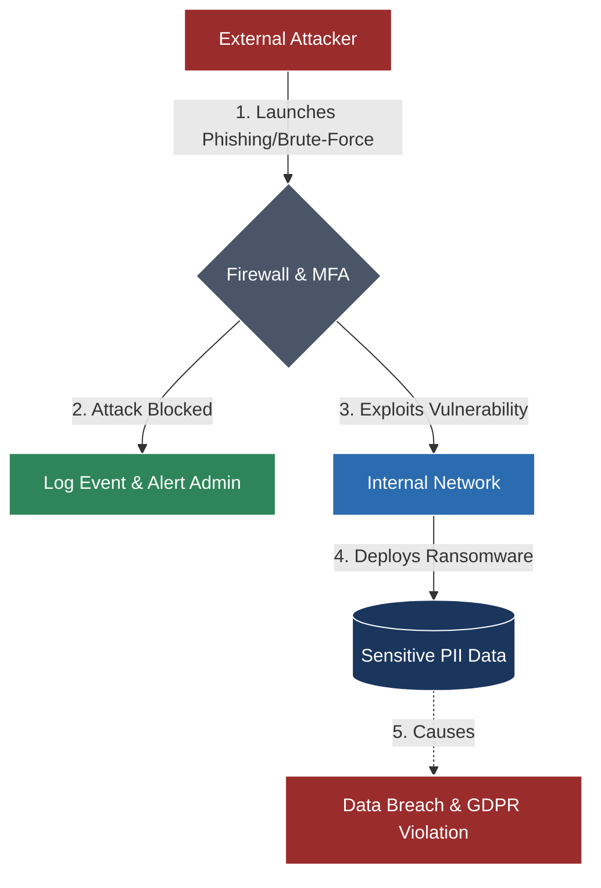

## 🧭 Navigation & Zusammenhänge
- **Vorausgesetztes Thema:** [[04_Technical English Cyber Security & Data Privacy]]
- **Nächstes Thema:** [[02_Überblick_S4HANA_Handbuch]]
- **Verwandte Bausteine:** [[02_Überblick_S4HANA_Handbuch]], [[03_Lernmethoden_Wissensmanagement]]
---

## 🎯 IHK-Prüfungsrelevanz
> [!IMPORTANT] AP01: Einrichten eines IT-gestützten Arbeitsplatzes
> - **Relevanz:** Hoch
> - **Fokus:** Erkennen von englischsprachigen Social-Engineering-Angriffen (Phishing-Mails), Einrichten sicherer Passwörter/MFA am Client und Verstehen von IT-Sicherheitsrichtlinien für Mitarbeiter (*Acceptable Use Policy*).

> [!WARNING] AP02: Konzeption, Administration & Netzwerke
> - **Relevanz:** Sehr Hoch
> - **Fokus:** Analyse von englischen Sicherheitsvorfällen (*Security Breaches*), Konfiguration von Verschlüsselungsprotokollen (TLS, SSH, IPsec), VPN-Fachbegriffe und Einhaltung von internationalen Datenschutzstandards bei Serverstrukturen.

---

## 📖 Einfache Erklärung & Praxisbeispiele
Die IT-Sicherheitswelt spricht ausnahmslos Englisch. Um Bedrohungen abzuwehren und Netzwerke abzusichern, musst du Angriffsvektoren und Schutzmaßnahmen präzise auf Englisch benennen und verstehen können.

### Unterthemen & Anschauliche Beispiele:

- **Cyber Threats & Attack Vectors (Bedrohungen & Angriffe):**
  - *malware / ransomware:* Schadsoftware / Erpressungstrojaner (Daten werden verschlüsselt).
  - *phishing / spear phishing:* Datendiebstahl per gefälschter Mail / gezielter Angriff auf Schlüsselpersonen.
  - *brute-force attack:* Automatisches Durchprobieren von Passwörtern.
  - *vulnerability / exploit:* Sicherheitslücke / Das Ausnutzen dieser Lücke.
  - 💡 **Praxisbeispiel:** In der AP02 analysierst du einen englischen Sicherheitsbericht: *"The corporate network was compromised due to an unpatched vulnerability in the firewall."* (Das Firmennetzwerk wurde aufgrund einer nicht gepatchten Sicherheitslücke in der Firewall kompromittiert).

- **Defense Mechanisms & Cryptography (Schutzmaßnahmen):**
  - *encryption / decryption:* Verschlüsselung / Entschlüsselung.
  - *multi-factor authentication (MFA):* Mehrfaktor-Authentifizierung.
  - *remediation / mitigation:* Behebung / Schadensminderung (Risiken minimieren).
  - *audit:* Eine Überprüfung der Systeme auf Sicherheits- und Compliance-Vorgaben.
  - 💡 **Praxisbeispiel:** Eine IHK-Handlungsanweisung fordert: *"Implement end-to-end encryption for all backup data transferred to the cloud storage."* (Implementiere eine Ende-zu-Ende-Verschlüsselung für alle Backup-Daten, die in den Cloud-Speicher übertragen werden).

- **Data Privacy & Compliance (Datenschutz):**
  - *GDPR (General Data Protection Regulation):* Die englische Bezeichnung für die DSGVO.
  - *PII (Personally Identifiable Information):* Personenbezogene Daten (z. B. Namen, IPs, Mailadressen).
  - *data breach:* Datenpanne / Datenleck.

---

## 📊 Visuelle Darstellung (Mermaid.js)

---

## 🧠 IHK-Vokabeltrainer (Sicherheits-Fachbegriffe)

| Englischer Fachbegriff | Deutsche Bedeutung | Typischer IHK-Kontext |
| :--- | :--- | :--- |
| **To patch / updates** | Einspielen von Sicherheitsupdates | "Systems must be patched regularly to avoid exploits." |
| **Access control list (ACL)** | Zugriffskontrollliste | Regelt, welche IPs oder User auf Ressourcen zugreifen dürfen. |
| **Confidentiality** | Vertraulichkeit (Teil der CIA-Triade) | Daten dürfen nur von Autorisierter eingesehen werden. |
| **Integrity & Availability** | Integrität & Verfügbarkeit | Daten sind unverändert und Systeme sind einsatzbereit. |
