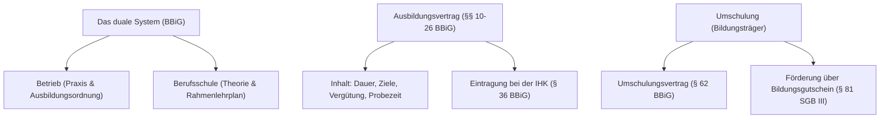

## tags: [fisi, ihk, lernsheet]

## 🧭 Navigation & Zusammenhänge

- **Vorausgesetztes Thema:**
    
- **Nächstes Thema:** [[02_Arbeits-, Sozial- und Mitbestimmungsrecht bei Bella Napoli]]
    
- **Verwandte Bausteine:** [[Aufbau- und Ablauforganisation]], [[Beschaffung & Vertragsrecht]]
    

## 🎯 IHK-Prüfungsrelevanz

> [!IMPORTANT] AP01: Einrichten eines IT-gestützten Arbeitsplatzes
> 
> - **Relevanz:** Mittel
>     
> - **Fokus:** Rechte und Pflichten von Auszubildenden am Arbeitsplatz, Einhaltung von Ausbildungsnachweisen und Jugendarbeitsschutzbestimmungen.
>     

> [!WARNING] AP02: Konzeption, Administration & Netzwerke
> 
> - **Relevanz:** Hoch
>     
> - **Fokus:** Rechtliche Grundlagen der Berufsausbildung und Umschulung nach BBiG, Bestandteile des Ausbildungsvertrags, Probezeit, Kündigungsfristen sowie die Struktur der Ausbildungsordnung für Fachinformatiker (FlAusbV).
>     

## 📖 Einfache Erklärung & Praxisbeispiele

Das duale System verknüpft die praktische Ausbildung im Betrieb mit der theoretischen Vermittlung in der Berufsschule (Lernortkooperation). Der Ausbildungsvertrag regelt dabei verbindlich die Rechte und Pflichten zwischen Ausbildenden und Auszubildenden auf Basis des Berufsbildungsgesetzes (BBiG). Für Umschulungen (z. B. zur Fachinformatikerin / zum Fachinformatiker) gelten spezifische Sonderregelungen und Umschulungsverträge über Bildungsträger.

### Unterthemen & Anschauliche Beispiele:

- **Das duale System & Lernorte:** Die Ausbildung findet an zwei Lernorten statt: Im Betrieb (auf Grundlage der Ausbildungsordnung und des BBiG) und in der Berufsschule (auf Grundlage des Rahmenlehrplans und des Schulgesetzes).
    
    - 💡 **Praxisbeispiel:** Ein angehender Systemintegrator lernt im Ausbildungsbetrieb die Konfiguration von Routern und Switches, während er in der Berufsschule die theoretischen Grundlagen der IP-Adressierung und Protokolle (OSI-Modell) vertieft.
        
- **Der Ausbildungsvertrag & Pflichtangaben:** Der Vertrag muss vor Beginn der Ausbildung in Textform (z. B. lesbar auf dauerhaftem Datenträger) abgefasst und von allen Parteien (bei Minderjährigen inkl. Eltern) unterzeichnet werden. Er enthält u. a. Ausbildungsziel, Dauer, Probezeit und Vergütung.
    
    - 💡 **Praxisbeispiel:** Der Ausbilder legt Giulia den Ausbildungsvertrag vor Ausbildungsbeginn in Textform vor und leitet ihn unverzüglich zur Eintragung an die zuständige IHK weiter.

## ⚠️ Typische IHK-Stolperfallen

- **Textform vs. Schriftform verwechseln:** In Prüfungen wird oft behauptet, ein Ausbildungsvertrag müsse zwingend per handschriftlicher Unterschrift auf Papier (Schriftform) geschlossen werden. Laut § 11 BBiG ist jedoch die _Textform_ (§ 126b BGB) vorgeschrieben – eine digitale Übermittlung (z. B. als PDF per E-Mail, sofern speicherbar) ist zulässig. Nach der Probezeit ist für Kündigungen hingegen die strenge _Schriftform_ mit handschriftlicher Unterschrift zwingend erforderlich (E-Mail/Messenger ist hier nichtig).
    
- **Unzulässige Vertragsbestandteile übersehen:** Klauseln wie eine Bindung nach der Ausbildung, Vertragsstrafen bei Ausbildungsabbruch oder Kostenbeteiligungen des Azubis an den Ausbildungsmitteln sind nach § 12 BBiG absolut verboten und rechtlich nichtig.
    
- **Verwechslung von Ausbildungsordnung und betrieblichem Ausbildungsplan:** Die Ausbildungsordnung (Bundes-Rechtsverordnung) gilt branchenweit für alle Betriebe, während der betriebliche Ausbildungsplan individuell vom Betrieb für den konkreten Azubi erstellt werden muss.
    
- **Umschulungsvertrag vs. Ausbildungsvertrag:** Bei einer Umschulung über einen Bildungsträger gelten die §§ 10–26 BBiG (und somit klassische Ausbildungsverträge) nicht; stattdessen greift der Umschulungsvertrag nach § 62 BBiG in Verbindung mit dem SGB III.
