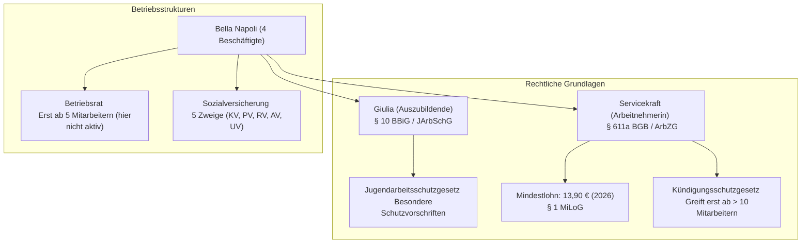

## tags: [fisi, ihk, lernsheet, m01, recht, arbeitsrecht]

## 🧭 Navigation & Zusammenhänge

- **Vorausgesetztes Thema:** [[01_Einführung_Allgemeine_BWL]]
    
- **Nächstes Thema:** [[03_Entgeltabrechnung_und_Steuern]]
    
- **Verwandte Bausteine:** [[Ausbildungsvertrag_und_BBiG]], [[Betriebsverfassungsgesetz_BetrVG]]
    

## 🎯 IHK-Prüfungsrelevanz

> [!IMPORTANT] AP01: Einrichten eines IT-gestützten Arbeitsplatzes
> 
> - **Relevanz:** Hoch
>     
> - **Fokus:** Die IHK prüft hier grundlegende Kenntnisse zum Arbeitsvertrag, den Unterschied zwischen Ausbildungsvertrag und Arbeitsvertrag nach BBiG/BGB sowie das Nachweisgesetz und den Jugendarbeitsschutz.
>     

> [!WARNING] AP02: Konzeption, Administration & Netzwerke
> 
> - **Relevanz:** Mittel
>     
> - **Fokus:** Vertiefung von Kündigungsfristen, Kündigungsschutzgesetz in Kleinbetrieben, Tarifvertragsrecht und Sozialversicherungspflichten im Rahmen der betrieblichen Organisation.
>     

## 📖 Einfache Erklärung & Praxisbeispiele

Das Arbeitsrecht regelt das Verhältnis zwischen Arbeitgeber und Beschäftigten. Am Beispiel der Gaststätte „Bella Napoli“ lassen sich typische vertragliche, arbeitszeitliche und sozialrechtliche Fragestellungen des betrieblichen Alltags praxisnah untersuchen.

### Unterthemen & Anschauliche Beispiele:

- **Arbeitsvertrag vs. Ausbildungsvertrag:**
    
    - _Ausbildungsvertrag (§ 10 BBiG):_ Dient dem Erlernen eines Berufs und endet mit Ablauf der Zeit oder bestandener Prüfung. Es gilt das Berufsbildungsgesetz.
        
    - _Arbeitsvertrag (§ 611a BGB):_ Regelt die Arbeitsleistung nach Weisung gegen Entgelt auf unbestimmte oder befristete Zeit.
        
    - 💡 **Praxisbeispiel:** Die Auszubildende Giulia lernt in der Küche nach dem BBiG, während die Servicekraft auf Basis eines normalen Arbeitsvertrags nach Weisung arbeitet.
        
- **Mindestlohn & Entgeltfortzahlung:**
    
    - _Mindestlohn:_ Seit dem 1. Januar 2026 gilt ein gesetzlicher Mindestlohn von 13,90 Euro brutto pro Zeitstunde (§ 1 MiLoG). Auszubildende sind nach § 22 Abs. 3 MiLoG ausgenommen.
        
    - _Krankheit:_ Nach einer vierwöchigen Wartezeit zahlt der Arbeitgeber bei unverschuldeter Krankheit das Entgelt bis zu sechs Wochen lang fort (§ 3 EntgFG).
        
    - 💡 **Praxisbeispiel:** Erkrankt die Servicekraft in ihrer dritten Woche bei Bella Napoli, besteht noch kein Anspruch auf Entgeltfortzahlung nach dem EntgFG.
        
- **Arbeitszeit & Jugendarbeitsschutz:**
    
    - _ArbZG für Erwachsene:_ Maximal 8 Stunden Werktagsarbeitszeit (erweiterbar auf 10 Stunden bei Ausgleich) sowie vorgeschriebene Pausen und Ruhezeiten.
        
    - _JArbSchG für Jugendliche (z. B. Giulia mit 17):_ Strikte Grenzen wie max. 8 Stunden täglich, 40 Stunden wöchentlich, Beschäftigung nur von 6 bis 22 Uhr in Gaststätten sowie verlängerte Freizeit zwischen den Schichten.
        
    - 💡 **Praxisbeispiel:** Giulia darf im Rahmen ihrer Schicht in der Gaststätte bis 22 Uhr abends eingesetzt werden (§ 14 JArbSchG).
        
- **Tarifvertrag & Mitbestimmung:**
    
    - _Tarifvertrag (TVG):_ Wirkt unmittelbar und zwingend, wenn beide Parteien tarifgebunden sind oder eine Allgemeinverbindlicherklärung vorliegt.
        
    - _Betriebsrat (BetrVG):_ Ein Betriebsrat kann ab fünf ständig wahlberechtigten Beschäftigten gewählt werden.
        
    - 💡 **Praxisbeispiel:** Da Bella Napoli insgesamt nur vier Beschäftigte hat (Giulia eingerechnet), wird die Schwelle für die Gründung eines Betriebsrats nach § 1 BetrVG nicht erreicht.

> [!IWARNING] ⚠️ Typische IHK-Stolperfallen

- **Ausbildungsvertrag vs. Arbeitsvertrag verwechseln:** In Prüfungen wird oft gefragt, ob für Azubis dieselben Regeln wie für Arbeitnehmer gelten. _Falle:_ Für den Ausbildungsvertrag gilt zwar das Arbeitsrecht nach § 10 Abs. 2 BBiG mit, soweit das BBiG nichts anderes regelt[cite: 3]. Aber: Azubis erhalten Ausbildungsvergütung (kein reguläres Gehalt nach § 611a BGB)[cite: 3] und fallen **nicht** unter das Mindestlohngesetz (§ 22 Abs. 3 MiLoG)[cite: 4]!
    
- **Kündigungsschutz im Kleinbetrieb falsch anwenden:** Die Annahme, dass eine fristgerechte Kündigung immer einen Grund nach dem Kündigungsschutzgesetz (KSchG) voraussetzt. _Falle:_ Das KSchG greift erst in Betrieben mit **mehr als 10 Arbeitnehmern** (§ 23 Abs. 1 KSchG). **Auszubildende zählen bei der Schwellenwertberechnung nicht mit**! Da Bella Napoli nur 4 Beschäftigte inkl. Azubi hat, braucht der Arbeitgeber für eine fristgerechte Kündigung keinen Grund nach § 1 KSchG.
    
- **Formvorschrift bei Kündigung und Nachweisgesetz ignorieren:** Kündigungen bedürfen zwingend der Schriftform auf Papier mit handschriftlicher Unterschrift (§ 623 BGB) – per E-Mail oder PDF sind sie absolut unwirksam! _Besonderheit Gastgewerbe:_ Auch der schriftliche Nachweis der Arbeitsbedingungen nach § 2 NachwG darf im Gaststättengewerbe wegen § 2a SchwarzArbG **nicht** digital als PDF übermittelt werden, sondern muss physisch auf Papier vorliegen.
    
- **Entgeltfortzahlung ab Tag 1 erwarten:** _Falle:_ Der Anspruch auf Lohnfortzahlung im Krankheitsfall nach § 3 EntgFG entsteht erst nach einer vierwöchigen ununterbrochenen Dauer des Arbeitsverhältnisses (Wartezeit nach § 3 Abs. 3 EntgFG). Erkrankt eine Arbeitskraft in den ersten 4 Wochen, zahlt der Arbeitgeber noch kein Entgelt fort[cite: 10, 26].
    
- **Betriebsrats- und JAV-Schwellenwerte verwechseln:**
    
    - _Betriebsrat:_ Erst ab mind. **5 wahlberechtigten Arbeitnehmern** (§ 1 BetrVG).
        
    - _Jugend- und Auszubildendenvertretung (JAV):_ Erst ab mind. **5 jugendlichen Arbeitnehmern oder Azubis** (§ 60 BetrVG)[cite: 24].
        
    - _Falle:_ Bei Bella Napoli (4 Beschäftigte) gibt es weder einen Betriebsrat noch eine JAV.
