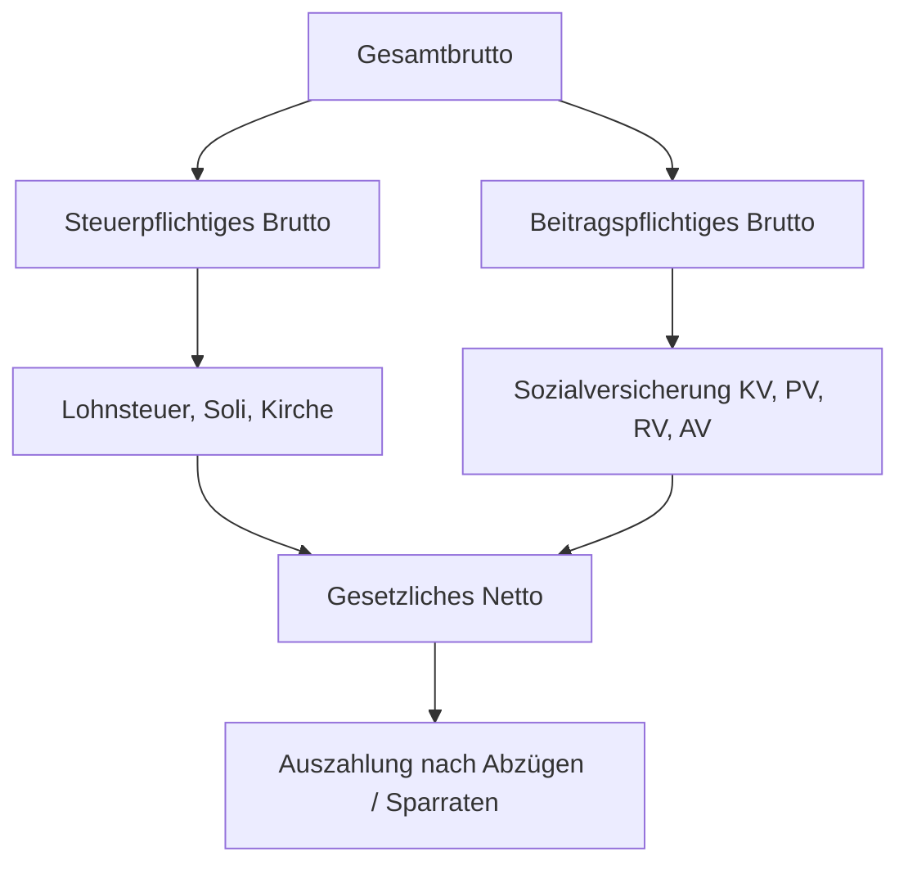

**Tags:** #[WirtschaftUndSoziales] #[Entgeltabrechnung] #[FisiPrüfung]

---

### 🗺️ Navigation & Zusammenfassung
* **Vorheriges Thema:** [[01_Arbeits_Sozial_und_Mitbestimmungsrecht]]
* **Nächstes Thema:** [[02_Netzwerkkonzepte_nach_Anwendungsgebiet]]
* **Verwandte Bausteine:** [[01_Duales_System_und_Ausbildungsvertrag]], [[01_Handlungskompetenz_und_Qualifikation]]

---

### 🎓 IHK-Prüfungsrelevanz: AP01 & AP02

> [!IMPORTANT] **🟢 IHK Prüfungsrelevanz: AP01 (Teil 1 der gestreckten Abschlussprüfung)**
> **Relevanz:** Mittel bis Basiswissen
> **Fokus:** In der AP1 werden grundlegende wirtschaftliche Zusammenhänge des Ausbildungsbetriebs, Rechte und Pflichten sowie einfache Berechnungen im Rahmen von Arbeitsverhältnissen (Brutto-Netto-Komponenten) abgefragt.

> [!INFO] **🔵 IHK Prüfungsrelevanz: AP02 (Teil 2 der gestreckten Abschlussprüfung)**
> **Relevanz:** Kernkompetenz im Wirtschafts- und Sozialteil (WiSo)
> **Fokus:** Hier musst du Entgeltbestandteile (wie Steuer- und Beitragspflichten), den Unterschied zwischen Bruttobeträgen sowie Fort- und Weiterbildungswege nach dem Berufsbildungsgesetz (BBiG) sicher anwenden und analysieren können.

---

### 📖 Einfache Erklärung & Praxisbeispiele

#### 💡 Das Konzept einfach erklärt
Stell dir die Entgeltabrechnung wie ein Sieb vor: Von dem Geld, das dein Chef dir schuldet (Gesamtbrutto), wandert ein Teil direkt zum Finanzamt (Steuern) und an die Sozialversicherungsträger (Kranken-, Pflege-, Renten- und Arbeitslosenversicherung). Übrig bleibt das gesetzliche Netto. Wichtig für die Prüfung ist, dass nicht jeder Lohnbestandteil gleich besteuert oder verbeitragt wird. Zudem hört das Lernen mit dem Abschluss nicht auf: Der Deutsche Qualifikationsrahmen (DQR) stuft den Fachinformatiker auf **Niveau 4** ein, und mit Fortbildungen (wie dem Geprüften Berufsspezialisten oder dem Bachelor Professional) kannst du gezielt aufsteigen.

#### 💻 Praxisbeispiel & Technische Umsetzung
Berechnung des Beitrags zur Krankenversicherung für einen Arbeitnehmer mit einem beitragspflichtigen Brutto von $2.640,00\text{ \euro}$ und einem kassenindividuellen Zusatzbeitrag (wovon die Hälfte der Arbeitnehmer trägt):
* Allgemeiner Beitragssatz GKV: $14,6\% \rightarrow$ Arbeitnehmeranteil = $7,3\%$
* Zusatzbeitrag (angenommen $2,9\%$) $\rightarrow$ Arbeitnehmeranteil = $1,45\%$
* Gesamter Beitragssatz für den Arbeitnehmer = $7,3\% + 1,45\% = 8,75\%$
* Rechenweg: 
  $$\text{KV-Anteil Arbeitnehmer} = 2.640,00\text{ \euro} \times 0,0875 = 231,00\text{ \euro}$$

---

### 📊 Visualisierung & Logik (Mermaid)

### ⚠️ IHK-Prüfungsstolperfallen

- **Stolperfalle 1:** Verwechslung von Gesamtbrutto, steuerpflichtigem Brutto und beitragspflichtigem Brutto. -> _Lösung:_ Merke dir, dass steuerfreie Zuschläge (z. B. bestimmte Nacht- oder Sonntagszuschläge nach § 3b EStG) zwar das Gesamtbrutto erhöhen, aber das steuer- und beitragspflichtige Brutto oft unberührt lassen.
    
- **Stolperfalle 2:** Annahme, dass der Arbeitgeber alle Sozialabgaben alleine trägt. -> _Lösung:_ In der Regel (außer bei der Unfallversicherung) teilen sich Arbeitgeber und Arbeitnehmer die Beiträge zur Sozialversicherung zu gleichen Teilen (bzw. bei der Krankenversicherung inkl. halbem Zusatzbeitrag)[cite: 7].
    
- **Stolperfalle 3:** Falsche Einschätzung des DQR-Niveaus für Fachinformatiker. -> _Lösung:_ Der Abschluss als Fachinformatiker liegt auf **DQR-Niveau 4**, nicht auf Niveau 6 (welches dem Bachelor an einer Hochschule entspricht)[cite: 23].