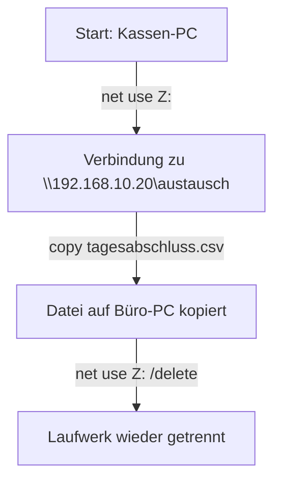

**Tags:** #[Systemtechnik] #[Netzwerktechnik] #[FisiPrüfung]

---
### 🗺️ Navigation & Zusammenfassung
* **Vorheriges Thema:** [[01_Arbeits_Sozial_und_Mitbestimmungsrecht]]
* **Nächstes Thema:** [[05_Verfügbarkeit_und_Wartung]]
* **Verwandte Bausteine:** [[02_Sicherheitskonzepte_und_Datenschutz]], [[02_Cloud_Computing_Modelle_und_Betriebswirtschaft]]

---
### 🎓 IHK-Prüfungsrelevanz: AP01 & AP02

> [!IMPORTANT] **🟢 IHK Prüfungsrelevanz: AP01 (Teil 1 der gestreckten Abschlussprüfung)**
> **Relevanz:** Sehr hoch (Grundlagen und Rechnen)
> **Fokus:** In der AP1 werden grundlegende Berechnungen zur Verfügbarkeit (bezogen auf konkrete Öffnungs- oder Betriebszeiten) sowie Basiswissen zur Normalisierung von Datenmodellen (bis zur 3. Normalform) und Schichtenmodellen abgefragt[cite: 4, 5, 6, 7, 9].

> [!INFO] **🔵 IHK Prüfungsrelevanz: AP02 (Teil 2 der gestreckten Abschlussprüfung)**
> **Relevanz:** Kernkompetenz Systemintegration
> **Fokus:** Du musst Netzwerktopologien, Verkabelungs- und Funkkonzepte, VLANs (IEEE 802.1Q), VPN-Standortkopplungen sowie die klassische IP-Konfiguration und Fehlersuche (mit Befehlen wie `ipconfig`, `ping`, `nslookup`, `tracert`) sicher für reale Betriebsszenarien planen und anwenden[cite: 10, 11, 13, 15, 16, 28, 29, 31, 32].

---
### 📖 Einfache Erklärung & Praxisbeispiele
#### 💡 Das Konzept einfach erklärt
Stell dir ein Computernetzwerk wie das Post- und Lagersystem eines Betriebs vor: Damit Daten fehlerfrei ankommen, müssen Geräte wissen, in welchem Netz sie sich befinden, welche IP-Adresse sie haben und wie sie den Weg zum Empfänger finden. Das OSI-Schichtmodell teilt diesen Weg in 7 überschaubare Schichten auf – von der reinen Bitübertragung auf Kabeln (Schicht 1) bis hin zur Anwendung (Schicht 7)[cite: 9, 12]. 
* **Netzwerkarten:** Je nach Ausdehnung sprechen wir von PAN (Persönlich), LAN (Gebäude), MAN (Stadt) oder WAN (Weltweit/Internet)[cite: 10].
* **VLAN (Virtual LAN):** Ermöglicht es, physische Switches logisch in getrennte Netze zu unterteilen (z. B. Kasse, Küche, Gäste-WLAN), damit Gäste niemals Zugriff auf sensible Kassendaten bekommen[cite: 16].
* **Datenaustausch & IP:** Jedes Gerät im IPv4-Netz benötigt eine eindeutige IP-Adresse sowie eine Subnetzmaske, die festlegt, welcher Teil der Adresse das Netz und welcher den Host identifiziert[cite: 23, 24]. Private IP-Bereiche nach RFC 1918 (z. B. `192.168.0.0/16`) werden im Internet nicht geroutet[cite: 25].

#### 💻 Praxisbeispiel & Technische Umsetzung
Überprüfung der Netzwerkkonfiguration und Erreichbarkeit an einer Kasse im Betrieb über die Kommandozeile (Windows):
* Eigene Konfiguration auslesen: 
  ```cmd
  ipconfig /all
  ```
* (Prüft, ob eine gültige IP-Adresse bezogen wurde und ob der DHCP-Server geantwortet hat – achte darauf, dass keine Notfall-IP im Bereich `169.254.x.x` vorliegt).

- Verbindung zum Standardgateway (Router) prüfen:
```meraid
graph TD
DOS
ping 192.168.10.1
```


- Netzwerklaufwerk für die Tagesabrechnung mit dem Büro-PC verbinden:


```Mermaid
graph TD
    A[Netzwerk-Anfrage] --> B[Schicht 7-5: Anwendung / Daten]
    B --> C[Schicht 4: Transport / TCP-Segment]
    C --> D[Schicht 3: Vermittlung / IP-Paket]
    D --> E[Schicht 2: Sicherung / Ethernet-Frame]
    E --> F[Schicht 1: Bitübertragung / Bits]
    F --> G[Übertragung über Kabel oder WLAN]
```
### ⚠️ IHK-Prüfungsstolperfallen

- **Stolperfalle 1:** Verwechslung von Schicht-2-Fehlern (z. B. falsches VLAN oder defekter Switch) und Schicht-1-Fehlern (z. B. abgerissenes Netzwerkkabel). -> _Lösung:_ Prüfe immer physisch zuerst das Medium (Schicht 1), bevor du logische Konfigurationen auf höheren Schichten untersuchst.
    
- **Stolperfalle 2:** Die automatische IP-Vergabe schlägt fehl und das Betriebssystem zeigt eine IP aus dem Bereich `169.254.x.x`. -> _Lösung:_ Dies ist eine APIPA-Notadresse (RFC 3927). Sie signalisiert, dass kein DHCP-Server erreichbar war; die Kasse kann so weder den Router noch andere Subnetze erreichen.
    
- **Stolperfalle 3:** Ein `ping`-Befehl schlägt fehl, obwohl der Rechner und die Freigabe erreichbar sind. -> _Lösung:_ Die Windows-Firewall des Zielrechners blockiert oft standardmäßig ICMP-Echo-Anfragen (`ping`). Nutze stattdessen Tools wie `Test-NetConnection -Port 445`, um zu prüfen, ob der spezifische Dienst (z. B. SMB) erreichbar ist
