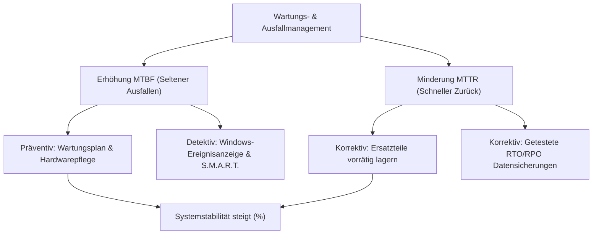

# 11_Verfügbarkeit und Wartung

**Tags:** #Systemtechnik #Verfügbarkeit #Wartung #PowerShell #FisiPrüfung #Lernfeld11

---

### 🗺️ Navigation & Zusammenfassung
* **Vorheriges Thema:** [[04_Netzwerkkonzepte_und_Datenaustausch]]
* **Nächstes Thema:** [[02_SQL-Datentypen & Domänen im Detail]]
* **Verwandte Bausteine:** [[06_Stromversorgung, USV & Netzformen]], [[01_IT-Vertragsarten & Leistungsdokumentation]]

---

### 🎓 IHK-Prüfungsrelevanz: AP01 & AP02

> [!IMPORTANT] **🟢 IHK Prüfungsrelevanz: AP01 (Teil 1 der gestreckten Abschlussprüfung)**
> * **Relevanz:** Sehr hoch / Basiswissen
> * **Fokus:** In der AP01 musst du die mathematischen Kernmetriken der Systemverfügbarkeit (\[MTBF\], \[MTTR\], Verlässlichkeit in \%) sicher berechnen können. Typisch sind auch Transferfragen zur Reduzierung von Ausfallzeiten durch strategische Ersatzteilbevorratung.

> [!INFO] **🔵 IHK Prüfungsrelevanz: AP02 (Teil 2 der gestreckten Abschlussprüfung)**
> * **Relevanz:** Kernkompetenz / Ergänzend
> * **Fokus:** In der AP02 steht die proaktive Fehlerminderung (Prävention, Detektion) im Vordergrund. Du musst komplexe Wartungspläne bewerten, Service-Level-Agreements (SLA) analysieren und mathematische Verknüpfungen von redundanten Systemen (Reihen- vs. Parallelschaltung) berechnen.

---

### 📖 Erklärung & Praxisbeispiele

#### 💡 Das Konzept einfach erklärt
In der IT-Welt geht es darum, Systeme am Laufen zu halten (**Verfügbarkeit**) und sie systematisch zu pflegen (**Wartung**), bevor es knallt. 
* **MTBF (Mean Time Between Failures):** Die mittlere Zeit zwischen zwei Ausfällen. Je höher dieser Wert ist, desto seltener fällt das System aus (proaktiver Schutz/Qualität).
* **MTTR (Mean Time To Repair):** Die mittlere Zeit die zur Wiederherstellung benötigt wird. Je kleiner dieser Wert ist, desto schneller läuft das System nach einem Crash wieder (reaktiver Schutz/Ersatzteile).

Maßnahmen zur Erhöhung der Zuverlässigkeit lassen sich in drei Dimensionen einteilen:
1. **Präventiv (Vorbeugend):** Verhindert das Entstehen von Fehlern (z. B. Log-Rotation, Staubwischen).
2. **Detektiv (Erkennend):** Meldet Vorzeichen, bevor ein System abstürzt (z. B. Schwellwert-Alarme in Logs).
3. **Korrektiv (Behebend):** Repariert den Zustand nach einem Vorfall (z. B. Einspielen einer Sicherung).

#### 💻 Praxisbeispiel & Technische Umsetzung
Ein Webshop-Szenario aus dem FISI-Alltag zeigt die mathematische Kalkulation:
Ein System wird über eine monatliche Bezugszeit von 30 Tagen (\[30 \times 24 \times 60 = 43.200 \text{ Minuten}\]) betrachtet. In dieser Zeit kam es zu **6 Ausfällen** mit einer Gesamtausfallzeit von **162 Minuten**.

Die Berechnung der IHK-Kennzahlen lautet wie folgt:

\[Betriebszeit = Bezugszeit - Ausfallzeit = 43.200 - 162 = 43.038 \text{ Minuten}\]

\[MTBF = \frac{Betriebszeit}{\text{Anzahl der Ausfälle}} = \frac{43.038}{6} = 7.173 \text{ Minuten}\]

\[MTTR = \frac{Ausfallzeit}{\text{Anzahl der Ausfälle}} = \frac{162}{6} = 27 \text{ Minuten}\]

\[Verfügbarkeit = \frac{MTBF}{MTBF + MTTR} = \frac{7.173}{7.173 + 27} = 99,625\%\]

---

### 📅 Der offizielle IT-Wartungsplan (IHK-Vorgabe)

Ein strukturierter Wartungsplan teilt Aufgaben in feste Intervalle ein, um die gesetzliche Betriebsbereitschaft und IT-Grundschutz-Compliance zu gewährleisten:

| Gegenstand | Tätigkeit | Intervall |
| :--- | :--- | :--- |
| **Küchen-Tablets** | In die Ladeschale stellen, Ladestand prüfen | Jedes Schichtende |
| **Kassen-PC** | Kassenjournal archivieren, freien Speicher prüfen | Monatlich |
| **Kassen-PC / Büro-PC** | Windows-Sicherheitsupdates evaluieren und einspielen | Monatlich (nach Patchday) |
| **Webshop & App** | Restlaufzeit der TLS-Zertifikate und Plattenplatz prüfen | Monatlich |
| **Kassen-PC & Router** | Gehäuselüfter und Lüftungsschlitze von Staub befreien | Halbjährlich |
| **USV (Akkumulator)** | Kapazitätstest und Batteriestatus-Validierung | Jährlich |

---

### 💻 PowerShell-Systemdiagnose (Prüfungswissen)

Zur administrativen Erkennung (**detektive Wartung**) von Systemengpässen und zur Update-Kontrolle nutzt du in Windows-Umgebungen die PowerShell:

| Befehl / Pipeline | Diagnose-Zweck | IHK-Praxismerkmal & Parameter |
| :--- | :--- | :--- |
| **`Get-Volume -DriveLetter C`** | Abfrage von Kapazität und Dateisystem-Inhalt. | Zeigt `SizeRemaining` (freier Speicher) und den `HealthStatus` an. |
| **`Get-PhysicalDisk`** | Physischer Zustand von SSDs/HDDs. | Prüft den `OperationalStatus` (z. B. "OK") und `HealthStatus`. |
| **`Get-HotFix`** | Kontrolle installierter Sicherheitsupdates. | Listet KB-Nummern, Installationsdatum (`InstalledOn`) und den User auf. |
| **`(Get-HotFix \| Sort-Object -Property InstalledOn)[-1]`** | Ermittlung des jüngsten Updates. | Sortiert alle Hotfixes chronologisch und gibt das letzte Element (`[-1]`) aus. |

---

### 📊 Visualisierung & Logik (Mermaid)

---

### ⚠️ IHK-Prüfungsstolperfallen
* **Stolperfalle 1:** Falsche Bezugszeit gewählt. Prüfungsaufgaben grenzen die relevante Zeit oft ein (z. B. "nur während der Öffnungszeit von 11 bis 23 Uhr") -> *Lösung:* Ausfälle außerhalb dieser definierten Betriebszeit dürfen nicht in die Berechnung der Verfügbarkeit einfließen.
* **Stolperfalle 2:** Speicherengpässe übersehen. In Praxisaufgaben wird oft ein `SizeRemaining`-Wert von z. B. 5% ausgegeben -> *Lösung:* In Produktivsystemen (wie Kassen- oder Webservern) löst das Unterschreiten kritischer Schwellwerte (meist unter 10-20%) sofortigen Alarm aus.
* **Stolperfalle 3:** Redundanz-Irrtum bei Ersatzkomponenten -> *Lösung:* Ein Ersatzgerät im Schrank erhöht niemals die MTBF (es fällt dadurch nicht seltener aus), sondern senkt ausschließlich die MTTR, weil der Austausch beschleunigt wird.

