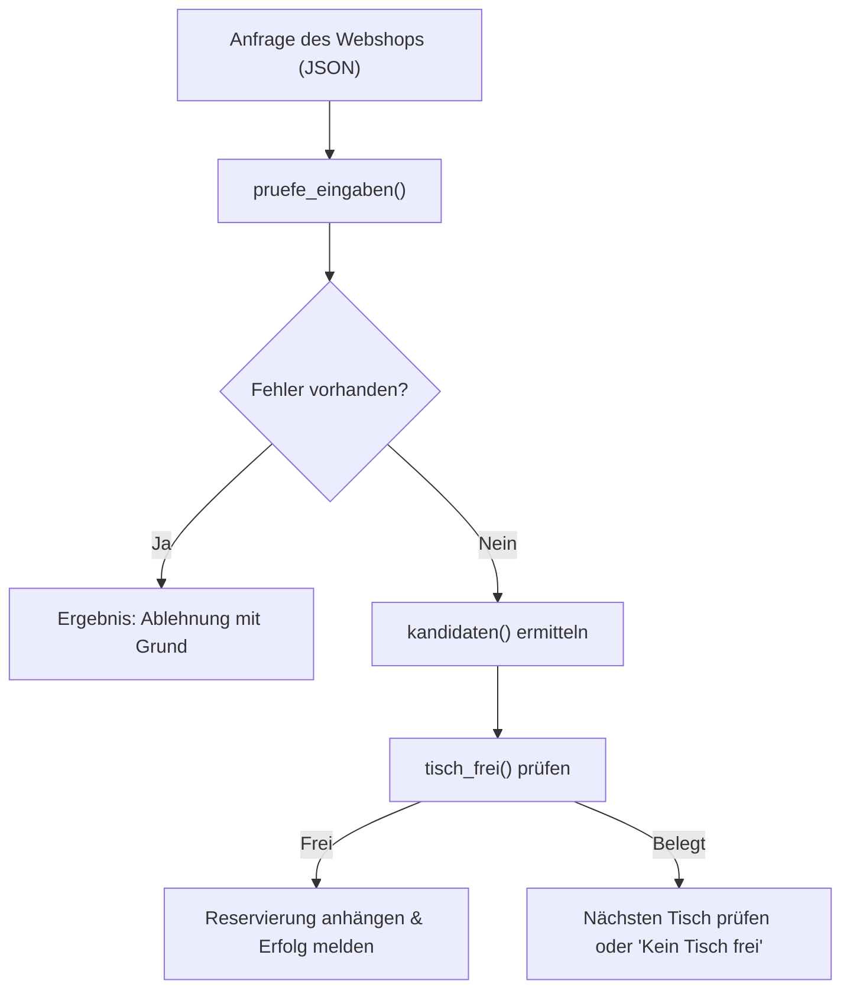

# 11_Fachrichtungsübergreifendes_Modul_I_Schnittstellen_und_Programmiersprachen

**Tags:** #[Fachrichtungsübergreifend] #[Schnittstellen] #[Programmiersprachen] #[FisiPrüfung]

---

### 🗺️ Navigation & Zusammenfassung
* **Vorheriges Thema:** [[04_Netzwerkstrukturen und Datenaustausch]]
* **Nächstes Thema:** [[05_Verfügbarkeit und Wartung]]
* **Verwandte Bausteine:** [[01_Einführung in Programmierlogik & Logikgrundlagen]], [[06_SQL_Datentypen & Dokumente im Detail]], [[03_IPv4-Adressierung & Adressierung]]

---

### 🎓 IHK-Prüfungsrelevanz: AP01 & AP02

> [!IMPORTANT] **🟢 IHK Prüfungsrelevanz: AP01 (Teil 1 der gestreckten Abschlussprüfung)**
> * **Relevanz:** Basiswissen für Logik, Datenstrukturen und Programmabläufe
> * **Fokus:** In der AP1 musst du Programmstrukturen, einfache Kontrollstrukturen (Schleifen, Bedingungen) und Datentypen (wie Ganzzahlen, Datumsangaben oder Listen) in Pseudocode oder Python nachvollziehen und anwenden können.

> [!INFO] **🔵 IHK Prüfungsrelevanz: AP02 (Teil 2 der gestreckten Abschlussprüfung)**
> * **Relevanz:** Kernkompetenz für Anwendungsentwicklung und Schnittstellendesign
> * **Fokus:** Hier wird verlangt, dass du Schnittstellenverträge (Vor- und Nachbedingungen, Signaturdefinitionen), Fehlerbehandlungsstrategien (Rückgabewerte vs. Exceptions) und objektorientierte oder prozedurale Implementierungen (z. B. in Python, Java oder JavaScript) konzipierst und bewertest. Auch die Sprachwahl nach Kriterien wie Typisierung, Laufzeitumgebung und Einsatzgebiet ist prüfungsrelevant.

---

### 📖 Einfache Erklärung & Praxisbeispiele

#### 💡 Das Konzept einfach erklärt
Stell dir den Betrieb eines Restaurants wie den Online-Shop von *Bella Napoli* vor: Verschiedene Programmteile müssen nahtlos zusammenarbeiten – genau wie Service, Küche und Kasse[cite: 1]. 
* **Schnittstellen (Contracts):** Eine Schnittstelle regelt exakt, was ein Programmteil vom anderen erwartet und was er garantiert (Vor- und Nachbedingungen)[cite: 5, 11]. Die Signatur definiert Name, Parameter, Typangaben und den Rückgabetyp[cite: 7].
* **Fehlerbehandlung:** Fehler im Betrieb (z. B. ein Gast vergisst eine Pflichtangabe) werden über Fehlerwerte wie `None` oder Fehlermeldungen als Rückgabewert gemeldet. Programmierfehler (z. B. ungültige Argumente wie eine negative Personenzahl) lösen Ausnahmen (*Exceptions* wie `ValueError`) aus[cite: 10].
* **Sprachvergleich & Typisierung:** 
  * *Statische Typisierung* (z. B. Java) prüft Typen bereits vor dem Start durch den Compiler, wodurch Typfehler sofort auffallen[cite: 22, 30].
  * *Dynamische Typisierung* (z. B. Python) prüft Typen erst zur Laufzeit (oder vorab durch Typprüfer wie `mypy`)[cite: 8, 22].
  * *Dynamische und schwache Typisierung* (z. B. JavaScript) wandelt Datentypen bei Bedarf stillschweigend um, was zu unbemerkten Fehlern führen kann[cite: 22, 30].

#### 💻 Praxisbeispiel & Technische Umsetzung
Definition einer typisierten Signatur mit Dataclasses und einer Funktion zur Tischprüfung in Python für das Reservierungssystem[cite: 7, 12]:

```python
from dataclasses import dataclass
from datetime import date

@dataclass
class Tisch:
    nummer: int
    plaetze: int
    bereich: str

@dataclass
class Reservierung:
    tisch: int
    tag: date
    beginn: int # Minuten seit Mitternacht

ZWEI_STUNDEN = 120 # Minuten

def tisch_frei(tisch: Tisch, tag: date, beginn: int, reservierungen: list[Reservierung]) -> bool:
    """Prüft, ob der Tisch am Tag zur Uhrzeit beginn frei ist.
    beginn ist die Uhrzeit in Minuten seit Mitternacht. Frei heißt,
    keine Reservierung an diesem Tisch und Tag beginnt weniger als
    120 Minuten davor oder danach. reservierungen bleibt unverändert.
    """
    for r in reservierungen:
        if r.tisch == tisch.nummer and r.tag == tag:
            if abs(r.beginn - beginn) < ZWEI_STUNDEN:
                return False
    return True
```



### ⚠️ IHK-Prüfungsstolperfallen

- **Stolperfalle 1:** Verwechslung von Objektgleichheit * **Stolperfalle 1:** Verwechslung von Objektgleichheit (`==` prüft bei Objekten in manchen Sprachen wie JavaScript oft nur, ob es exakt dasselbe Speicherobjekt ist) mit Wertegleichheit -> *Lösung:* Stattdessen Attribute direkt vergleichen (z. B. `r.tisch === tisch.nummer`) oder typsichere Vergleiche (wie `.equals()` in Java oder Textrepräsentationen für Datumswerte) nutzen. prüft bei Objekten in manchen Sprachen wie JavaScript oft nur, ob es exakt dasselbe Speicherobjekt ist) mit Wertegleichheit -> _Lösung:_ Stattdessen Attribute direkt vergleichen (z. B. `r.tisch === tisch.nummer`) oder typsichere Vergleiche (wie `.equals()` in Java oder Textrepräsentationen für Datumswerte) nutzen.
    
- **Stolperfalle 2:** Annahme, dass Python Typangaben im Quelltext zur Laufzeit automatisch erzwingt -> _Lösung:_ Python ignoriert Typangaben (`tag: date`) standardmäßig zur Laufzeit; für eine statische Vorabprüfung müssen externe Typprüfer wie `mypy` eingesetzt werden.
    
- **Stolperfalle 3:** Falsche Wahl der Fehlerbehandlungsart (Exceptions für normale Benutzerfehler statt programminterne Vorbedingungen) -> _Lösung:_ Betriebliche Eingabefehler als Rückgabewert (z. B. `str | None`) signalisieren; echte Programmierfehler (verletzte Vorbedingungen) über `raise ValueError` abfangen.