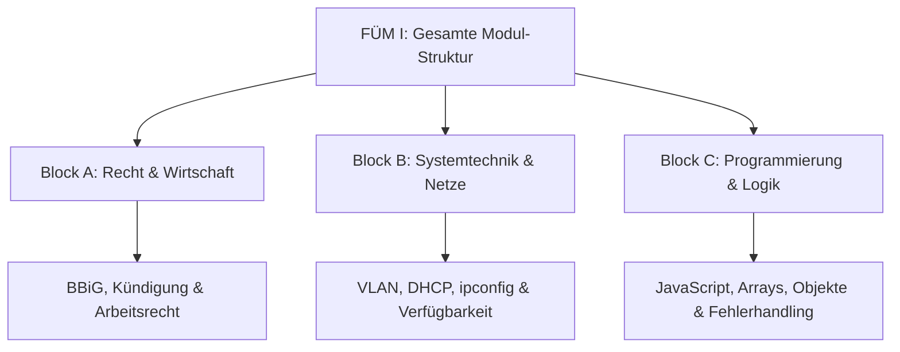

**Tags:** #[JavaScript] #[IHKPrüfung] #[Recht] #[Systemtechnik]

---

### 🗺️ Navigation & Zusammenfassung
* **Vorheriges Thema:** [[10_Branchenspezifische_ERP_Software]] <!-- ⚠️ Nicht vorhanden – Bitte erstellen -->
* **Nächstes Thema:** [[12_Fachspezifisches_Modul_1]] <!-- ⚠️ Nicht vorhanden – Bitte erstellen -->
* **Verwandte Bausteine:** [[01_Das duale System & der Ausbildungskontext]], [[04_Netzwerkstrukturen und Datenaustausch]], [[05_Verfügbarkeit und Wartung]]

---

### 🎓 IHK-Prüfungsrelevanz: AP01 & AP02

> [!IMPORTANT] **🟢 IHK Prüfungsrelevanz: AP01 (Teil 1 der gestreckten Abschlussprüfung)**
> * **Relevanz:** Sehr hoch (Grundlagen und praxisnahe Transferleistung)
> * **Fokus:** In der AP1 werden häufig wirtschaftliche und rechtliche Grundlagen (wie das BBiG, Arbeits- und Vertragsrecht) sowie elementares logisches Verständnis von Programmstrukturen und Verfügbarkeitsberechnungen gefordert.

> [!INFO] **🔵 IHK Prüfungsrelevanz: AP02 (Teil 2 der gestreckten Abschlussprüfung)**
> * **Relevanz:** Kernkompetenz
> * **Fokus:** Vertiefte Kenntnisse in Netzwerktopologien, Redundanzberechnungen, Fehlerbehandlung und das Lesen bzw. Analysieren von Programmierlogiken (wie JavaScript-Arrays, Objekten und Fehlerfällen) bilden das Fundament für komplexe Systemintegrationen.

---

### 📖 Einfache Erklärung & Praxisbeispiele

#### 💡 Das Konzept einfach erklärt
Das fachrichtungsübergreifende Modul verbindet drei essenzielle Welten für deinen Beruf als Fachinformatiker für Systemintegration (FISI):
1. **Recht & Berufsbildung:** Das duale System nach BBiG, Arbeitsrecht, Entgeltsysteme und vertragliche Grundlagen (z. B. Kündigungsfristen und Schriftform).
2. **Systemtechnik & Betrieb:** Netzwerkinfrastrukturen, VLANs, DHCP, Netzwerk-Troubleshooting via Konsole (`ipconfig`, `ping`, `nslookup`, `tracert`) und die mathematische Berechnung von Verfügbarkeiten (Serien- und Parallelschaltungen).
3. **Programmierung & Datenstrukturen:** Der Vergleich von Python und JavaScript. Du lernst, wie man Code in einer zweiten Programmiersprache liest, mit Arrays, Objekten, Typisierungen (z. B. `number`, `string`) und Ausnahmen (`try`/`catch`, `RangeError`) umgeht.

#### 💻 Praxisbeispiel & Technische Umsetzung
* **Verfügbarkeitsberechnung bei Redundanz:** 
  Wenn du Komponenten parallel betreibst (z. B. zwei Kartenlesegeräte mit je 99,5% Verfügbarkeit), fällt das System nur aus, wenn **beide** Geräte versagen. Die Ausfallwahrscheinlichkeit des Paares berechnet sich als Produkt der Einzel-Ausfallwahrscheinlichkeiten ($0,005 \times 0,005 = 0,000025$). Daraus ergibt sich eine Verfügbarkeit des Paares von $99,9975\%$. Liegt davor und dahinter eine Reihenschaltung (z. B. Kassen-PC und Internetanschluss), multiplizierst du die Dezimalwerte.
* **JavaScript vs. Python (Typisierung & Fehler):**
  In JavaScript führt die Addition von Text und Zahl (`"1020" + 90`) zu einer automatischen String-Konkatenation (`"102090"`), während Python hier einen `TypeError` wirft. Daher ist bei Formulareingaben immer eine explizite Konvertierung via `Number(eingabe)` notwendig.

---

### 📊 Visualisierung & Logik (Mermaid)

### ⚠️ IHK-Prüfungsstolperfallen

- **Stolperfalle 1:** Die Verwechslung von Reihen- und Parallelschaltung bei der Verfügbarkeit. -> _Lösung:_ In Reihe multiplizieren sich die Verfügbarkeiten direkt ($V_1 \times V_2$). Bei parallelen Redundanzen multiplizierst du zuerst die Ausfallwahrscheinlichkeiten ($1 - V$) und ziehst das Ergebnis von $1$ ab.
    
- **Stolperfalle 2:** Annahme, dass JavaScript bei Typ-Vermischung (`"1020" + 90`) einen Fehler wirft. -> _Lösung:_ JavaScript konvertiert implizit in Text; nutze stattdessen `Number()`, um saubere mathematische Operationen sicherzustellen.
    
- **Stolperfalle 3:** Kündigung im Ausbildungsverhältnis per Messenger (WhatsApp etc.). -> _Lösung:_ Nach § 22 Abs. 3 BBiG ist die Schriftform zwingend vorgeschrieben; digitale Nachrichten verstoßen gegen die Formvorschrift und sind nach § 125 BGB nichtig.