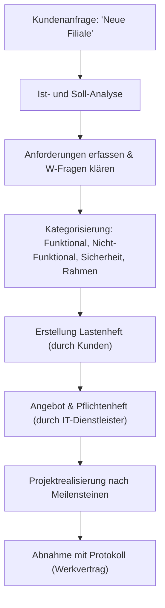

# 08_Anforderungen_aufnehmen_und_Projektstart

**Tags:** #Projektmanagement #Lastenheft #Werkvertrag #FisiPrüfung

---

### 🗺️ Navigation & Zusammenfassung
* **Vorheriges Thema:** [[08_01_IT-Vertragsarten & Leistungsdokumentation]] <!-- ⚠️ Nicht vorhanden – Bitte erstellen -->
* **Nächstes Thema:** [[02_Change Management & IT-Kommunikation]]
* **Verwandte Bausteine:** [[02_Kaufmännische Kalkulationen]], [[🔍Glossar]]

---

### 🎓 IHK-Prüfungsrelevanz: AP01 & AP02

> [!IMPORTANT] **🟢 IHK Prüfungsrelevanz: AP01 (Teil 1 der gestreckten Abschlussprüfung)**
> * **Relevanz:** Basiswissen
> * **Fokus:** In der AP1 musst du häufig Kundenanforderungen strukturiert aufnehmen, klassifizieren (funktional, nicht-funktional, Sicherheit, Rahmenbedingungen) und verständlich dokumentieren.

> [!INFO] **🔵 IHK Prüfungsrelevanz: AP02 (Teil 2 der gestreckten Abschlussprüfung)**
> * **Relevanz:** Kernkompetenz
> * **Fokus:** Hier geht es um die rechtliche Einordnung von Verträgen (Werkvertrag vs. Kaufvertrag) sowie um das Erstellen von Pflichtenheften, Meilensteinen und das Durchführen einer fachgerechten Abnahme.

---

### 📖 Einfache Erklärung & Praxisbeispiele

#### 💡 Das Konzept einfach erklärt
Stell dir vor, ein Kunde (wie das Autohaus Veritas) kommt zu dir und sagt: *„Mach mal IT, so wie in der Zentrale, nur moderner.“*[cite: 6] Wenn du jetzt blind Hardware bestellst, hast du garantiert verloren. Als FISI musst du erst das **Mengengerüst** klären (Wer arbeitet womit?) und vage Begriffe wie „sicher“ oder „modern“ in harte, prüfbare Fakten übersetzen[cite: 7]. 
Dabei unterscheiden wir:
* **Ist-Zustand:** Wo stehen wir heute? (z. B. leere Räume)[cite: 8]
* **Soll-Zustand:** Was muss am Stichtag exakt funktionieren?[cite: 8]
* **Anforderungskategorien:** Unterteilung in funktionale, nicht-funktionale Anforderungen, Sicherheit und Rahmenbedingungen[cite: 12].

Rechtlich ist zudem entscheidend: Die Installation und Einrichtung einer funktionierenden Gesamtanlage ist ein **Werkvertrag** (du schuldest einen *Erfolg*, am Ende gibt es ein Abnahmeprotokoll). Reiner Hardwarekauf zwischen Kaufleuten unterliegt dem Handelsrecht (§ 377 HGB: sofortige Untersuchung und Rügepflicht)[cite: 5].

#### 💻 Praxisbeispiel & Technische Umsetzung
Beispielhafter Auszug aus einer strukturierten Anforderungsanalyse für die Filiale West des Autohauses Veritas:
* **Funktional:** Alle 18 Mitarbeiter greifen über VPN auf das zentrale DMS zu; im Autohaus wird gedruckt[cite: 11].
* **Nicht-funktional:** Ein Ausfall des DMS darf maximal einen halben Arbeitstag betragen[cite: 11].
* **Sicherheit:** Das Kunden-WLAN (2 Access Points) ist strikt vom internen Netz getrennt und hat keinen Zugriff auf das DMS[cite: 11].
* **Rahmenbedingungen:** Fester Eröffnungstermin ist der 01.03.2027, das Budget liegt bei ca. 40.000 € netto[cite: 11].

---

### 📊 Visualisierung & Logik (Mermaid)

### ⚠️ IHK-Prüfungsstolperfallen

- **Stolperfalle 1:** Verwechslung von Werkvertrag und Kaufvertrag bei der Projektabnahme. -> _Lösung:_ Bei der Errichtung einer IT-Gesamtanlage handelt es sich um einen Werkvertrag nach BGB. Es wird ein konkreter Erfolg geschuldet, die Vergütung fällig nach erfolgreicher Abnahme mit Protokoll.
    
- **Stolperfalle 2:** Unklare Anforderungen im Angebot akzeptieren (z. B. „System muss schnell sein“). -> _Lösung:_ Anforderungen müssen immer messbar und prüfbar formuliert sein (z. B. „DMS-Reaktionszeit unter 2 Sekunden“).
    
- **Stolperfalle 3:** Missachtung der kaufmännischen Rügepflicht nach § 377 HGB bei Hardware-Lieferungen zwischen Unternehmen. -> _Lösung:_ Gelieferte Ware muss unverzüglich auf Mängel geprüft und Mängel sofort gerügt werden, sonst gilt die Ware als genehmigt.