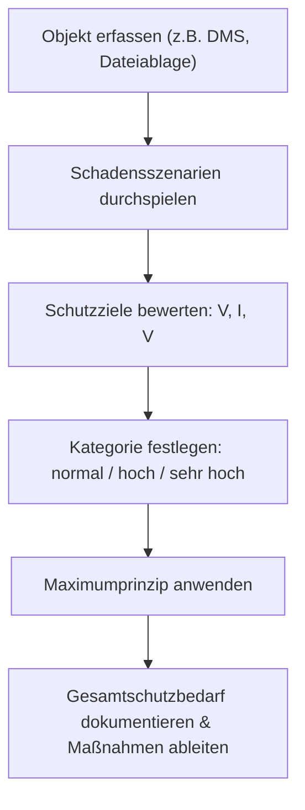

**Tags:** #[IT-Sicherheit] #[Schutzbedarf] #[Datenschutz] #[FisiPrüfung]

---

### 🗺️ Navigation & Zusammenfassung
* **Vorheriges Thema:** [[02_Sicherheit_im_Konzept_und_Schutzbedarfsfeststellung]]
* **Nächstes Thema:** [[16_Security by Design, IT-Grundschutz & Kontrollebenen]]
* **Verwandte Bausteine:** [[02_Sicherheitskonzepte]], [[02_DSGVO_und BDSG]]

---

### 🎓 IHK-Prüfungsrelevanz: AP01 & AP02

> [!IMPORTANT] **🟢 IHK Prüfungsrelevanz: AP01 (Teil 1 der gestreckten Abschlussprüfung)**
> * **Relevanz:** Basiswissen für IT-Sicherheit und Gefährdungsbeurteilung
> * **Fokus:** In der AP1 musst du Grundwerte der Informationssicherheit (CIA-Trias) anwenden und einfache Schadensszenarien für IT-Systeme bewerten können.

> [!INFO] **🔵 IHK Prüfungsrelevanz: AP02 (Teil 2 der gestreckten Abschlussprüfung)**
> * **Relevanz:** Kernkompetenz im Bereich IT-Sicherheitskonzepte
> * **Fokus:** Hier wird verlangt, dass du eine strukturierte Schutzbedarfsfeststellung (angelehnt an BSI-Standards) für IT-Objekte durchführst, das *Maximumprinzip* anwendest und daraus begründete Sicherheitsmaßnahmen ableitest.

---

### 📖 Einfache Erklärung & Praxisbeispiele

#### 💡 Das Konzept einfach erklärt
Nicht jedes System und nicht jede Datei im Unternehmen benötigt denselben extremen Sicherheitsaufwand – das wäre viel zu teuer und unpraktikabel. Deshalb ermitteln wir den **Schutzbedarf**[cite: 28]. 
* **Die Schutzziele (CIA-Trias & Erweiterung):**
  * *Vertraulichkeit:* Nur Berechtigte dürfen Informationen einsehen (z. B. Kundendaten, Kaufverträge)[cite: 22].
  * *Integrität:* Daten müssen korrekt, vollständig und vor unbemerkter Manipulation geschützt sein (z. B. Rechnungsbeträge, Zeiterfassung)[cite: 23].
  * *Verfügbarkeit:* Systeme müssen dann laufen, wenn sie gebraucht werden (z. B. DMS-Zugriff im Autohaus)[cite: 24].
  * *Ergänzend:* *Authentizität* (Echtheit von Absender/Gerät, Schutz vor CEO-Fraud) und *Verbindlichkeit* (Nichtabstreitbarkeit von Handlungen, z. B. Reparaturfreigaben).
* **Schutzbedarfskategorien (nach BSI):**
  * *Normal:* Schaden ist überschaubar (unter 5.000 €)[cite: 29].
  * *Hoch:* Schaden ist beträchtlich (5.000 bis 50.000 €, Ausfallzeit max. ein halber Arbeitstag, personenbezogene Daten betroffen)[cite: 29].
  * *Sehr hoch:* Existenzbedrohend (über 50.000 €, Gefahr für Leib und Leben)[cite: 29].
* **Das Maximumprinzip:** Der Gesamt-Schutzbedarf eines Systems richtet sich immer nach dem **höchsten Einzelwert** seiner Schutzziele. Wenn ein Server hochsensible Daten speichert (Vertraulichkeit: *hoch*), erbt das gesamte System diesen Schutzbedarf, selbst wenn die Verfügbarkeit nur *normal* wäre.

#### 💻 Praxisbeispiel & Technische Umsetzung
Beispielhafter Auszug aus der Schutzbedarfsfeststellung für die *Filiale West* des Autohauses Veritas:
* **DMS-Zugriff (über VPN):** Vertraulichkeit = *hoch*, Integrität = *hoch*, Verfügbarkeit = *hoch* (Ausfallmax. $\frac{1}{2}$ Tag) $\rightarrow$ **Gesamt: hoch** (Hauptgrund: Ohne DMS steht die Filiale)[cite: 34].
* **Kunden-WLAN:** Vertraulichkeit = *normal*, Integrität = *normal*, Verfügbarkeit = *normal* $\rightarrow$ **Gesamt: normal** (Isoliertes Gastnetz ohne Zugriff auf interne Netze)[cite: 34].

---

### 📊 Visualisierung & Logik (Mermaid)

### ⚠️ IHK-Prüfungsstolperfallen

- **Stolperfalle 1:** Den Schutzbedarf nur nach Gefühl schätzen statt nach festen Kriterien und Schadensszenarien. -> _Lösung:_ Jede Schutzbedarfskategorie muss im Konzept kurz begründet werden (z. B. Gesetzliche Vorgaben, DSGVO, finanzielle Auswirkungen).
    
- **Stolperfalle 2:** Falsche Anwendung des Maximumprinzips (z. B. Durchschnitt aus den Schutzzielen bilden). -> _Lösung:_ Gilt für ein einzelnes Schutzziel der Wert „hoch“, ist der **Gesamtwert automatisch „hoch“**[cite: 30].
    
- **Stolperfalle 3:** Verwechslung von Authentizität und Vertraulichkeit bei Phishing oder gefälschten Mails. -> _Lösung:_ Wenn ein Angreifer vorgibt, eine andere Person zu sein (z. B. Chef fordert Überweisung), ist primär die _Authentizität_ verletzt.