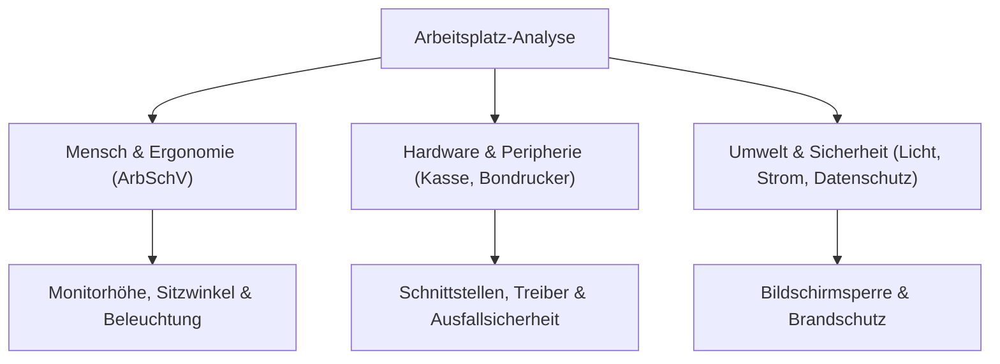

**Tags:** #[Fachrichtungsübergreifend] #[Arbeitsplatz] #[Ergonomie] #[FisiPrüfung]

---

### 🗺️ Navigation & Zusammenfassung
* **Vorheriges Thema:** [[01_Das duale System & der Ausbildungskontext]]
* **Nächstes Thema:** [[03_Entgeltabrechnung - Lesen,_Umfang und Ausflug]]
* **Verwandte Bausteine:** [[02_Management_Projektplanung & Arbeitsplatz-Ergonomie]], [[04_Sicherheit,_Gesundheit und Ergonomie]], [[16_Arbeitsplätze nach Kundenwunsch ausstatten - Schnittstellen & Perig...]]

---

### 🎓 IHK-Prüfungsrelevanz: AP01 & AP02

> [!IMPORTANT] **🟢 IHK Prüfungsrelevanz: AP01 (Teil 1 der gestreckten Abschlussprüfung)**
> * **Relevanz:** Basiswissen im Bereich Arbeitsplatzgestaltung und Arbeitssicherheit
> * **Fokus:** In der AP1 werden grundlegende Anforderungen an ergonomische Bildschirmarbeitsplätze (nach ArbSchV, DGUV) sowie die korrekte Auswahl und Dimensionierung von IT-Peripherie und Hardware-Komponenten für spezifische Anwendungsfälle (z. B. Kassensysteme, Gastronomie) abgefragt.

> [!INFO] **🔵 IHK Prüfungsrelevanz: AP02 (Teil 2 der gestreckten Abschlussprüfung)**
> * **Relevanz:** Kernkompetenz für Konzeption und Beschaffung
> * **Fokus:** Hier musst du ganzheitliche IT-Arbeitsplätze nach Kundenwünschen planen, Schnittstellen (USB, HDMI, DisplayPort, Netzwerk) bewerten, Wirtschaftlichkeits- und Leistungsdaten vergleichen sowie Aspekte des Gesundheitsschutzes und der Stromversorgung (inkl. Schutzmaßnahmen und Green IT) in Projekten berücksichtigen.

---

### 📖 Einfache Erklärung & Praxisbeispiele

#### 💡 Das Konzept einfach erklärt
Stell dir vor, du richtest den IT-Arbeitsplatz für eine neue Filiale ein (wie zum Beispiel das Restaurant *Bella Napoli* oder ein modernes Autohaus). Es reicht nicht aus, einfach PCs und Bildschirme hinzustellen – alles muss perfekt auf den Menschen und die betrieblichen Prozesse abgestimmt sein.
* **Ergonomie am Bildschirmarbeitsplatz:** Nach der Arbeitsstättenverordnung (ArbSchV) und den DGUV-Vorgaben muss ein Arbeitsplatz so gestaltet sein, dass Ermüdung und Haltungsschäden vermieden werden. Wichtige Faktoren sind:
  * *Bildschirm:* Mindestens 20–22 Zoll, flimmerfrei, blendfrei, neigbar und höhenverstellbar. Die oberste Zeile des Bildschirms liegt auf oder knapp unter Augenhöhe.
  * *Sitzhaltung:* Dynamisches Sitzen im 90-Grad-Winkel (Hüfte, Knie, Ellbogen), Füße stehen flach auf dem Boden oder einer Fußstütze.
  * *Umgebung:* Blendfreie Beleuchtung (kein direktes Sonnenlicht im Rücken oder auf dem Bildschirm), angemessene Raumtemperatur und niedrige Lärmbelastung.
* **Hardware & Peripherie:** Auswahl von Eingabegeräten (ergonomische Tastaturen, Mäuse), Bondruckern, Barcodescannern oder Kassen-Touchscreens passend zum Einsatzbereich (Gastronomie vs. Industrie-Werkstatt).

#### 💻 Praxisbeispiel & Technische Umsetzung
Checkliste für die Einrichtung eines Kassen- und Verwaltungsarbeitsplatzes bei *Bella Napoli*:
1. **Peripherie-Anbindung:** Anschluss des Bondruckers via USB/Ethernet und des Barcodescanners im HID-Modus (Tastaturemulation) an den Kassen-PC.
2. **Ergonomie-Check:** Höhenverstellbaren Tisch auf die Körpergröße des Mitarbeiters einstellen; Monitor-Arm so positionieren, dass der Sehabstand ca. 50 bis 70 cm beträgt.
3. **Energie- und Sicherheitskonfiguration:** Aktivierung des Energiesparmodus im Betriebssystem nach 15 Minuten Inaktivität; Absicherung des Arbeitsplatzes bei Abwesenheit (Tastenkombination `Windows + L` zum Sperren des Bildschirms).

---

### 📊 Visualisierung & Logik (Mermaid)

### ⚠️ IHK-Prüfungsstolperfallen

- **Stolperfalle 1:** Ergonomie wird in der Projektplanung komplett ignoriert oder nur auf den Stuhl reduziert. -> _Lösung:_ Ergonomie umfasst das gesamte Zusammenspiel aus Tisch, Stuhl, Beleuchtung, Blickwinkel, Raumklima und Software-Oberflächen.
    
- **Stolperfalle 2:** Ungeeignete Schnittstellen für Peripheriegeräte wählen (z. B. serielle Bondrucker an modernen PCs ohne Schnittstellenkarte). -> _Lösung:_ Immer moderne Schnittstellen (USB, Ethernet, WLAN) und deren Kompatibilität prüfen.
    
- **Stolperfalle 3:** Vernachlässigung des Datenschutzes am Arbeitsplatz (z. B. frei einsehbarer Monitor für Gäste). -> _Lösung:_ Bildschirme so aufstellen oder mit Blickschutzfiltern versehen, dass Unbefugte keine sensiblen Kundendaten einsehen können.