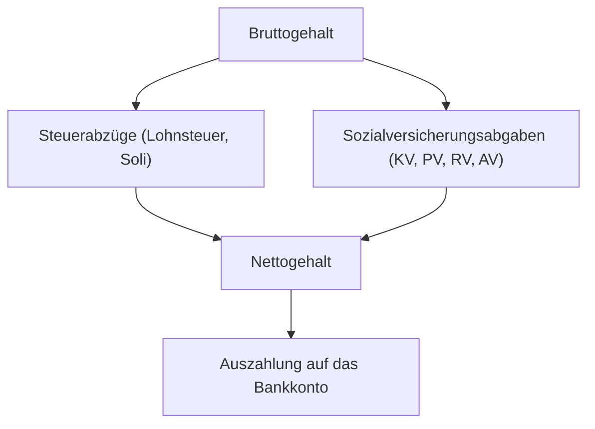

**Tags:** #[WirtschaftUndSoziales] #[Entgeltabrechnung] #[FisiPrüfung]

---

### 🗺️ Navigation & Zusammenfassung
* **Vorheriges Thema:** [[02_Arbeitsplatzausstattung bei Bella Napoli]]
* **Nächstes Thema:** [[04_Netzwerkstrukturen und Datenaustausch]]
* **Verwandte Bausteine:** [[01_Das duale System & der Ausbildungskontext]], [[03_Entgeltabrechnung - Lesen,_Umfang und Ausflug]]

---

### 🎓 IHK-Prüfungsrelevanz: AP01 & AP02

> [!IMPORTANT] **🟢 IHK Prüfungsrelevanz: AP01 (Teil 1 der gestreckten Abschlussprüfung)**
> * **Relevanz:** Basiswissen / Wirtschafts- und Sozialkunde
> * **Fokus:** In der AP1 werden grundlegende Bestandteile eines Arbeitsverhältnisses, gesetzliche Vorgaben des Entgelts sowie elementare Abzüge (Steuern und Sozialversicherung) im Rahmen von Wirtschafts- und Sozialkunde abgefragt.

> [!INFO] **🔵 IHK Prüfungsrelevanz: AP02 (Teil 2 der gestreckten Abschlussprüfung)**
> * **Relevanz:** Kernkompetenz im WiSo-Teil
> * **Fokus:** Hier musst du Entgeltabrechnungen detailliert lesen, Brutto-Netto-Komponenten (Steuerklassen, Beitragsbemessungsgrenzen, Arbeitnehmer- und Arbeitgeberanteile) berechnen und arbeitsrechtliche Rahmenbedingungen sicher anwenden können.

---

### 📖 Einfache Erklärung & Praxisbeispiele

#### 💡 Das Konzept einfach erklärt
Stell dir die Entgeltabrechnung wie eine feine Waage vor: Du arbeitest, erreichst ein Bruttogehalt, aber bevor das Geld auf deinem Konto landet, greifen der Staat und die Sozialkassen zu. 
* **Brutto vs. Netto:** Das Bruttoentgelt ist dein vereinbarter Lohn. Das Nettoentgelt ist das, was nach allen Abzügen (Steuern und Sozialabgaben) übrig bleibt.
* **Die Säulen der Sozialversicherung:** 
  1. *Krankenversicherung (KV)* & *Pflegeversicherung (PV)*
  2. *Rentenversicherung (RV)*
  3. *Arbeitslosenversicherung (AV)*
  *Hinweis:* Die Beiträge werden in der Regel zu gleichen Teilen (je zur Hälfte) von Arbeitnehmer und Arbeitgeber getragen (Ausnahme: Zusatzbeitrag der Krankenkasse wird teils unterschiedlich gewichtet, und die Unfallversicherung zahlt allein der Arbeitgeber).
* **Beitragsbemessungsgrenze (BMG):** Bis zu dieser Verdienstgrenze werden Beiträge erhoben. Alles, was darüber hinausgeht, bleibt beitragsfrei.

#### 💻 Praxisbeispiel & Technische Umsetzung
Ein Angestellter hat ein monatliches, beitragspflichtiges Bruttoentgelt von $3.000,00\text{ \euro}$. 
* Rentenversicherungssatz gesamt: $18,6\%$ $\rightarrow$ Arbeitnehmeranteil = $9,3\%$.
* Berechnung des Arbeitnehmeranteils zur Rentenversicherung:
  $$\text{RV-Anteil} = 3.000,00\text{ \euro} \times 0,093 = 279,00\text{ \euro}$$

---

### 📊 Visualisierung & Logik (Mermaid)

### IHK-Prüfungsstolperfallen

- **Stolperfalle 1:** Annahme, dass der Arbeitgeber die Sozialabgaben komplett allein bezahlt. -> _Lösung:_ Bis auf die Unfallversicherung teilen sich Arbeitgeber und Arbeitnehmer die Beiträge zur Sozialversicherung grundsätzlich paritätisch (zu je 50%).
    
- **Stolperfalle 2:** Verwechslung von Steuerpflichtigem und Sozialversicherungspflichtigem Brutto. -> _Lösung:_ Es gibt bestimmte Entgeltbestandteile (z. B. Sachbezüge oder steuerfreie Aufwandsentschädigungen), die unterschiedlich behandelt werden; prüfe immer die genaue Bemessungsgrundlage.
    
- **Stolperfalle 3:** Ignorieren der Beitragsbemessungsgrenzen bei überdurchschnittlich hohen Gehältern. -> _Lösung:_ Oberhalb der BMG fällt kein weiterer prozentualer Beitrag für die jeweilige Sozialversicherung an.