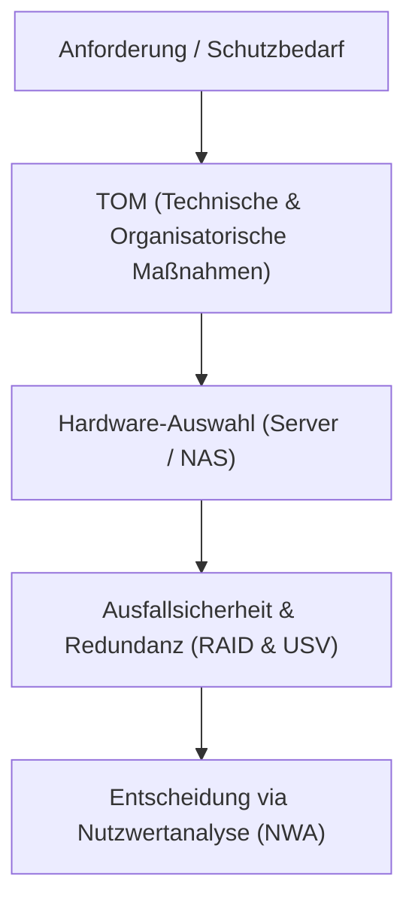

**Tags:** #[Systemtechnik] #[Hardware] #[RAID] #[USV] #[FisiPrüfung]

---

### 🗺️ Navigation & Zusammenfassung
* **Vorheriges Thema:** [[01_Computer-Formfaktoren & Hardware-Layouts]]
* **Nächstes Thema:** [[03_Bussysteme & Prozessoren]]
* **Verwandte Bausteine:** [[02_Datenspeicher & Sicherheit RAM, Massenspeicher, RAID & Dateisyst...]], [[07_Sicherheit,_Normen & Green IT]], [[10_Angebotsvergleich & Nutzwertanalyse (NWA)]]

---

### 🎓 IHK-Prüfungsrelevanz: AP01 & AP02

> [!IMPORTANT] **🟢 IHK Prüfungsrelevanz: AP01 (Teil 1 der gestreckten Abschlussprüfung)**
> * **Relevanz:** Basiswissen für IT-Systeme und Betriebssicherheit
> * **Fokus:** In der AP1 musst du grundlegende Hardware-Komponenten (Server, Speicher, USV) unterscheiden und einfache Anforderungen an die Betriebssicherheit (z. B. Schutz vor Stromausfällen) bewerten können.

> [!INFO] **🔵 IHK Prüfungsrelevanz: AP02 (Teil 2 der gestreckten Abschlussprüfung)**
> * **Relevanz:** Kernkompetenz im Bereich Systemintegration & Konzeption
> * **Fokus:** Hier wird verlangt, dass du begründete Hardware-Auswahlentscheidungen triffst (z. B. Server vs. NAS), RAID-Level mathematisch und logisch anwendest sowie Entscheidungen transparent mittels Nutzwertanalyse (NWA) für Kunden aufbereitest.

---

### 📖 Einfache Erklärung & Praxisbeispiele

#### 💡 Das Konzept einfach erklärt
Wenn ein Kunde wie das Autohaus Veritas eine neue Filiale ausstattet, stehen wir vor der Frage: Welche Hardware wird benötigt[cite: 38]? Ein normaler Büro-PC (Client) reicht für zentrale Dienste nicht aus. Wir brauchen Hardware für den **Dauerbetrieb** (Server oder Business-NAS)[cite: 49].
* **Technische & Organisatorische Maßnahmen (TOM nach Art. 32 DSGVO):** Datenschutz verlangt Datensicherheit[cite: 40, 41]. Wir trennen sauber zwischen technischen Maßnahmen (z. B. Firewall, VPN, Verschlüsselung) und organisatorischen Maßnahmen (z. B. Passwortrichtlinien, Notfallpläne, Wiederherstellungstests)[cite: 42, 43].
* **Server-Merkmale:** Ein echter Server unterscheidet sich vom Client durch ECC-Arbeitsspeicher (Fehlerkorrektur), Hot-Swap-Festplatten, redundante Netzteile und dedizierte Fernwartungs-Anschlüsse (z. B. iLO/iDRAC)[cite: 51].
* **RAID-Stufen:** Sichern die *Verfügbarkeit* beim Ausfall einer Festplatte (z. B. RAID 1 als Spiegelung oder RAID 5 mit Parität)[cite: 52, 53]. **Wichtig:** RAID ersetzt niemals ein Backup (schützt nicht vor Löschen, Ransomware oder Brand)!
* **USV (Unterbrechungsfreie Stromversorgung):** Schützt sensible Hardware vor Stromausfällen und Spannungsschwankungen und fährt Server kontrolliert herunter.
* **Nutzwertanalyse (NWA):** Hilft, objektive und subjektive Kriterien (wie Anschaffungskosten, Support, Flexibilität) zu gewichten, um zwischen Alternativen (z. B. Tower-Server vs. Business-NAS) nachvollziehbar zu entscheiden[cite: 56].

#### 💻 Praxisbeispiel & Technische Umsetzung
Auswahl für die Filiale West im Vergleich:
* **Tower-Server (z. B. HPE ProLiant):** Flexibel, ideal für virtuelle Maschinen und Windows Server, teurer in Anschaffung und Lizenzierung[cite: 55].
* **Business-NAS (z. B. Synology):** Günstiger, stromsparend, hervorragend für reine Dateiablage und Backups, aber eingeschränkt bei Spezialsoftware[cite: 50, 55].
* **RAID-Berechnung:** Bei 4 Festplatten à 4 TB (Gesamtkapazität 16 TB) bietet RAID 5 nutzbare 12 TB (1 Platte verliert sich für die Parität) und toleriert den Ausfall von genau 1 Festplatte[cite: 52].

---

### 📊 Visualisierung & Logik (Mermaid)

### ⚠️ IHK-Prüfungsstolperfallen

- **Stolperfalle 1:** Die Behauptung, dass ein RAID-System ein Backup ersetzt. -> _Lösung:_ Ein RAID sichert nur die _Verfügbarkeit_ bei Hardwaredefekt; gegen Ransomware, Feuer oder versehentliches Löschen hilft nur ein echtes Backup nach der 3-2-1-Regel[cite: 53].
    
- **Stolperfalle 2:** Laserdrucker an eine USV anschließen. -> _Lösung:_ Laserdrucker haben extrem hohe Anlaufströme (Heizelement), die eine normale IT-USV sofort überlasten und zerstören können. Drucker gehören _nicht_ an die USV[cite: 54].
    
- **Stolperfalle 3:** Technische und organisatorische Maßnahmen verwechseln. -> _Lösung:_ Eine Firewall ist _technisch_; eine verpflichtende Passwortrichtlinie oder eine Mitarbeiterschulung ist _organisatorisch_.