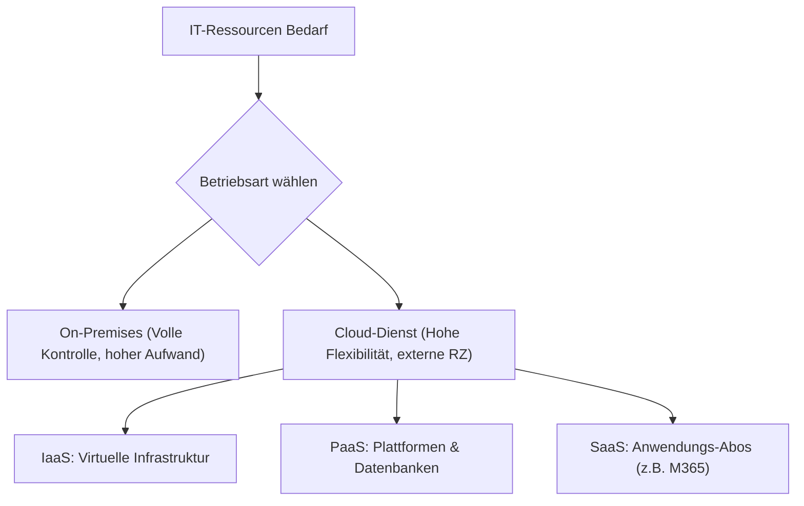

# 02_Cloud-Dienste_und_externe_IT-Ressourcen

**Tags:** #[CloudComputing] #[SaaS] #[Datenschutz] #[FisiPrüfung]

---

### 🗺️ Navigation & Zusammenfassung
* **Vorheriges Thema:** [[08_Betriebssysteme_und_Virtualisierung]]
* **Nächstes Thema:** [[09_Software-Qualität, Testing & Künstliche Intelligenz]]
* **Verwandte Bausteine:** [[07_Security by Design,_IT-Grundschutz & Kontroll-Ebenen]], [[10_Angebotsvergleich & Nutzwertanalyse (NWA)]]

---

### 🎓 IHK-Prüfungsrelevanz: AP01 & AP02

> [!IMPORTANT] **🟢 IHK Prüfungsrelevanz: AP01 (Teil 1 der gestreckten Abschlussprüfung)**
> * **Relevanz:** Basiswissen für IT-Ressourcen und Beschaffung
> * **Fokus:** In der AP1 musst du grundlegende Betriebsarten (On-Premises vs. Cloud) und einfache Merkmale von Cloud-Diensten (NIST-Kriterien) unterscheiden können.

> [!INFO] **🔵 IHK Prüfungsrelevanz: AP02 (Teil 2 der gestreckten Abschlussprüfung)**
> * **Relevanz:** Kernkompetenz im Bereich Cloud-Integration & Compliance
> * **Fokus:** Hier wird verlangt, dass du Servicemodelle (IaaS, PaaS, SaaS) abgrenzt, rechtliche Rahmenbedingungen (DSGVO, Auftragsverarbeitung nach Art. 28, Rechenzentrumsstandort USA/EU) bewertest und Wirtschaftlichkeitsvergleiche (Kauf vs. Miete / TCO) durchführst.

---

### 📖 Einfache Erklärung & Praxisbeispiele

#### 💡 Das Konzept einfach erklärt
Nicht jede IT-Ressource muss im eigenen Keller stehen. Wenn ein Unternehmen wächst, stellt sich die Frage: Kaufen wir eigene Server (On-Premises) oder nutzen wir externe Clouddienste[cite: 87, 89]?
* **Cloud-Merkmale nach NIST:** Eine echte Cloud zeichnet sich durch Selbstbedienung, netzwerkbasierte Erreichbarkeit, mandantenfähige Ressourcenpools, schnelle Elastizität und verbrauchsbasierte Abrechnung aus[cite: 90].
* **Servicemodelle im Überblick:**
  * *IaaS (Infrastructure as a Service):* Du mietest virtuelle Server, Speicher und Netzwerke; um das Betriebssystem und die Patches kümmerst du dich selbst[cite: 91, 92].
  * *PaaS (Platform as a Service):* Du bekommst eine fertige Laufzeitumgebung oder Datenbank; du verwaltest nur noch deine eigene Anwendung[cite: 91, 92].
  * *SaaS (Software as a Service):* Die komplette Anwendung wird über die Cloud bereitgestellt (z. B. Microsoft 365); du nutzt und verwaltest nur noch die Benutzerkonten[cite: 91, 92].
* **Recht & Datenschutz (Art. 28 DSGVO):** Wer personenbezogene Daten an einen Cloud-Anbieter übergibt, benötigt zwingend einen Vertrag zur **Auftragsverarbeitung (AVV)**[cite: 100]. Dabei bleibt das Unternehmen rechtlich die verantwortliche Stelle[cite: 100].

#### 💻 Praxisbeispiel & Technische Umsetzung
Wirtschaftlichkeits- und Architektur-Entscheidung:
* **Die Cloud-Komponente:** Microsoft 365 Business Premium wird als SaaS-Modell gemietet, um Exchange-Postfächer, Teams und die zentrale Geräteverwaltung (Intune) abzudecken[cite: 104, 108].
* **Der On-Premises-Anteil:** Kundensensible Dateiablagen verbleiben aus Sicherheitsgründen lokal auf dem NAS oder im eigenen Serverraum[cite: 108].
* **Kauf (CAPEX) vs. Miete (OPEX):** Einmalige Investitionskosten (Kauf von Hardware/Lizenzen) werden den laufenden, flexiblen Betriebskosten (Miete/Cloud-Abos) über die Gesamtlaufzeit (TCO) gegenübergestellt[cite: 103].

---

### 📊 Visualisierung & Logik (Mermaid)

### ⚠️ IHK-Prüfungsstolperfallen

- **Stolperfalle 1:** Annahme, dass bei SaaS der Anbieter auch für den Datenschutz und die Benutzerverwaltung zuständig ist. -> _Lösung:_ Die Verantwortung für Daten, Berechtigungen und Zugriffsrechte verliegt _immer_ beim Kunden!
    
- **Stolperfalle 2:** Fehlender AVV bei Cloud-Dienstleistern. -> _Lösung:_ Sobald ein externer Dienstleister Zugriff auf personenbezogene Daten hat (z. B. Cloud-Backup, M365), ist ein schriftlicher Vertrag zur Auftragsverarbeitung (Art. 28 DSGVO) gesetzlich vorgeschrieben.
    
- **Stolperfalle 3:** Vernachlässigung der Exit-Strategie (Vendor-Lock-in). -> _Lösung:_ Vor Vertragsabschluss müssen Klauseln zu Datenexport in Standardformaten, Löschfristen und Portabilität vertraglich fixiert werden.
