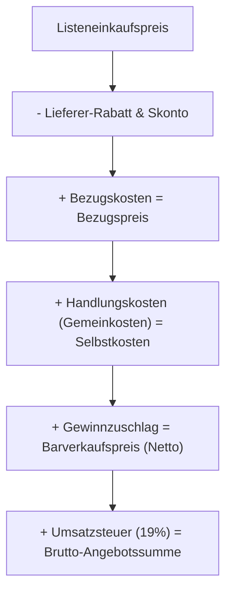

**Tags:** #[Projektmanagement] #[Vertragsrecht] #[Handelskalkulation] #[FisiPrüfung]

---

### 🗺️ Navigation & Zusammenfassung
* **Vorheriges Thema:** [[08_Formale Abnahme,_Mängelprotokolle & Projektabschluss]]
* **Nächstes Thema:** [[08_Kosten erfassen und bewerten (Kostenartenrechnung)]]
* **Verwandte Bausteine:** [[01_IT-Vertragsarten & Leistungsdokumentation]], [[10_Angebotsvergleich & Nutzwertanalyse (NWA)]], [[07_Sicherheit,_Normen & Green IT]]

---

### 🎓 IHK-Prüfungsrelevanz: AP01 & AP02

> [!IMPORTANT] **🟢 IHK Prüfungsrelevanz: AP01 (Teil 1 der gestreckten Abschlussprüfung)**
> * **Relevanz:** Basiswissen im Bereich Vertragsarten und kaufmännische Grundlagen
> * **Fokus:** In der AP1 musst du grundlegende Verträge (Kauf-, Werk-, Dienst- und Mietvertrag) unterscheiden und einfache rechtliche Bindungen von Angeboten (§ 145 BGB) bewerten können.

> [!INFO] **🔵 IHK Prüfungsrelevanz: AP02 (Teil 2 der gestreckten Abschlussprüfung)**
> * **Relevanz:** Kernkompetenz im Bereich Projektkalkulation & Angebotserstellung
> * **Fokus:** Hier wird verlangt, dass du eine vollständige **Handelskalkulation** (vom Listeneinkaufspreis über Handlungskosten und Gewinn zum Barverkaufspreis) durchführst, Angebote strukturiert aufbaust und Wirtschaftlichkeitsbetrachtungen anstellst.

---

### 📖 Einfache Erklärung & Praxisbeispiele

#### 💡 Das Konzept einfach erklärt
Wenn das Konzept (Anforderungen, Schutzbedarf, Hardware, Software) steht, geht es an den Vertrag und das **Angebot**[cite: 110, 115]. 
* **Bindung an das Angebot:** Eine Anfrage ist unverbindlich[cite: 116]. Ein Angebot hingegen ist eine Willenserklärung, die den Anbieter rechtlich bindet (§ 145 BGB)[cite: 116]. Ohne Frist gilt ein Angebot unter Anwesenden (auch am Telefon) nur sofort, per Mail oder Brief so lange, wie man üblicherweise auf Antwort warten darf[cite: 117]. Mit Frist (§ 148 BGB) ist der Anbieter bis zu diesem Datum gebunden[cite: 117].
* **Vertragsarten im IT-Projekt:**
  * *Kaufvertrag (§ 433 BGB):* Lieferung von mangelfreier Hardware (PCs, NAS).
  * *Werkvertrag (§ 631 BGB):* Erstellung eines geschuldeten *Erfolgs* inklusive Abnahme mit Protokoll (z. B. Installation und Inbetriebnahme der Filial-IT)[cite: 119].
  * *Dienstvertrag (§ 611 BGB):* Erbringung einer *Tätigkeit* ohne Erfolgserfolgsgarantie (z. B. Wartungsvertrag mit festen Reaktionszeiten)[cite: 119].
  * *Mietvertrag (§ 535 BGB):* Überlassung auf Zeit (z. B. Cloud-Abos wie Microsoft 365, Backup-Speicher)[cite: 119].
* **Handelskalkulation (Vorwärtskalkulation):** Vom Einkaufspreis über Handlungskosten und Gewinn zum Netto-Verkaufspreis[cite: 124].

#### 💻 Praxisbeispiel & Technische Umsetzung
Beispiel für eine klassische **Handelskalkulation** (Vorwärtskalkulation) bei Net-ist-Netz:
* Listeneinkaufspreis: $1.000,00 \text{ \euro}$[cite: 125]
* $\minus$ Lieferer-Rabatt ($10\%$) = $900,00 \text{ \euro}$ (Zieleinkaufspreis)[cite: 125]
* $\minus$ Skonto ($2\%$) = $882,00 \text{ \euro}$ (Bareinkaufspreis)[cite: 125]
* $\plus$ Bezugskosten (Fracht/Versicherung) = $900,00 \text{ \euro}$ (Bezugspreis)[cite: 125]
* $\plus$ Handlungskosten (z. B. Gemeinkostenzuschlag von $20\%$) = $1.080,00 \text{ \euro}$ (Selbstkosten)
* $\plus$ Gewinnzuschlag (z. B. $10\%$) = **$1.188,00 \text{ \euro}$** (Barverkaufspreis netto)[cite: 126]

---

### 📊 Visualisierung & Logik (Mermaid)

### ⚠️ IHK-Prüfungsstolperfallen

- **Stolperfalle 1:** Verwechslung von Werkvertrag und Dienstvertrag hinsichtlich der Leistungspflicht. -> _Lösung:_ Beim Werkvertrag schuldest du einen konkreten _Erfolg_ (das System muss laufen), beim Dienstvertrag nur das fachgerechte Bemühen (die _Tätigkeit_, z. B. Support-Stunden)[cite: 119].
    
- **Stolperfalle 2:** Falsche Reihenfolge oder Prozentsätze bei der Handelskalkulation anwenden. -> _Lösung:_ Handlungskosten und Gewinn werden immer auf den _Bezugspreis_ bzw. die _Selbstkosten_ aufgeschlagen – achte exakt auf die Rechenschritte in der Vorwärtskalkulation.
    
- **Stolperfalle 3:** Annahme, dass ein Werbeprospekt oder Webshop-Eintrag ein rechtlich bindendes Angebot ist. -> _Lösung:_ Das sind rechtlich unverbindliche _Anpreisungen_; erst die Bestellung des Kunden stellt das eigentliche Angebot dar.