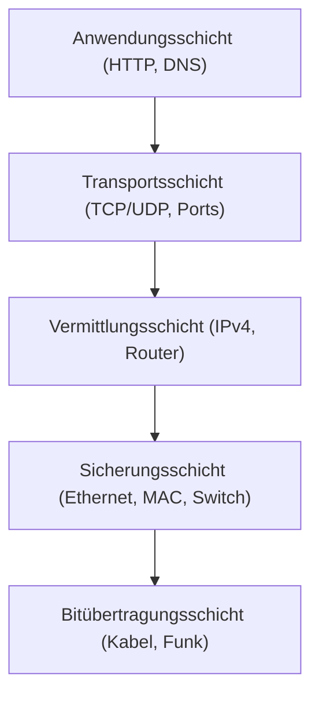

**Tags:** #[Netzwerktechnik] #[OSIModell] #[TCP_IP] #[Subnetting] #[FisiPrüfung]

---

### 🗺️ Navigation & Zusammenfassung
* **Vorheriges Thema:** [[06_01_Datenübertragung - Netzwerke,_Ressourcen & Ressourcenvermittlung]]
* **Nächstes Thema:** [[06_03_IPv4-Adressierung & Adressierung]]
* **Verwandte Bausteine:** [[06_02_Das ISO_OSI-Referenzmodell & TCP_IP_Schichtenmodell]], [[06_05_IPv4-Grundlagen,_Subnetting & Adressierung]], [[03_Fachbezogenes Rechnen & Digitaltechnik]]

---

### 🎓 IHK-Prüfungsrelevanz: AP01 & AP02

> [!IMPORTANT] **🟢 IHK Prüfungsrelevanz: AP01 (Teil 1 der gestreckten Abschlussprüfung)**
> * **Relevanz:** Basiswissen & Kernkompetenz
> * **Fokus:** In der AP1 musst du grundlegende Netzwerkkomponenten (Switches, Router, Firewalls) den korrekten Schichten des OSI- und TCP/IP-Modells zuordnen und Datenraten sowie Basis-Kalkulationen durchführen können.

> [!INFO] **🔵 IHK Prüfungsrelevanz: AP02 (Teil 2 der gestreckten Abschlussprüfung)**
> * **Relevanz:** Kernkompetenz
> * **Fokus:** Hier wird tiefgehendes Praxiswissen verlangt: IP-Adressierung, Subnetting (Berechnung von Netzadresse, Broadcast, Host-Anzahl und CIDR-Masken per UND-Verknüpfung) sowie die Konfiguration von Netzstrukturen (wie z. B. in unserer Filiale West).

---

### 📖 Einfache Erklärung & Praxisbeispiele

#### 💡 Das Konzept einfach erklärt
Stell dir vor, du planst das Netzwerk für eine neue Firmenfiliale (wie die Filiale West im Autohaus Veritas)[cite: 4, 6]. Da Kommunikation von Kabeln über IP-Adressen bis hin zur Webanwendung alles umfasst, teilen wir die Aufgaben in Schichten auf[cite: 7]. Jede Schicht kümmert sich um ihr eigenes Problem und nutzt die Schicht darunter[cite: 7]. 

* **OSI- und TCP/IP-Modell:** Das 7-Schichten-OSI-Modell dient als theoretisches Referenzmodell zum Lernen und Vergleichen, während das 4-Schichten-TCP/IP-Modell in der Praxis im Internet und in Unternehmensnetzen läuft[cite: 9].
* **Kapselung (Encapsulation):** Beim Senden packen die Schichten nacheinander Header (wie Briefumschläge) um die Daten. Der Router packt am Übergang bis Schicht 3 aus und leitet das Paket mit neuer MAC-Adresse weiter[cite: 12].
* **Adressierung:**
  * **MAC-Adresse (Schicht 2):** 48 Bit, weltweit einmalig, direkt auf der Netzwerkkarte, gilt nur im lokalen Netz[cite: 13].
  * **IP-Adresse (Schicht 3):** 32 Bit (IPv4), logische Adresse, wird für den Weg über Netzwerkgrenzen hinweg benötigt[cite: 13, 14].
  * **Port (Schicht 4):** 16 Bit (0–65.535), steuert die genaue Anwendung im Gerät (z. B. Port 443 für HTTPS)[cite: 8, 13].
* **Subnetting & Rechnen:** Mit einer Subnetzmaske trennen wir den Netzanteil vom Hostanteil[cite: 14]. Durch bitweises UND-Verknüpfen der IP-Adresse mit der Maske ermitteln wir die Netzadresse. Der Broadcast hat in diesem Netz alle Hostbits auf 1 gesetzt[cite: 24]. Die Anzahl nutzbarer Hosts berechnet sich über die Formel $$2^{n} - 2$$ (wobei $n$ die Anzahl der Hostbits ist)[cite: 24].

#### 💻 Praxisbeispiel & Technische Umsetzung
Beispiel aus der Filiale West: Ein /24-Netzwerk ($192.168.23.0/24$) wird in vier gleich große /26-Netzwerke unterteilt (64 Adressen pro Block)[cite: 26]:
* **Verwaltung:** $192.168.23.0/26$ (Netzadresse), Gateway: $.1$, nutzbare Hosts: $.2$ bis $.62$, Broadcast: $.63$[cite: 26, 27]
* **Verkauf:** $192.168.23.64/26$, Gateway: $.65$, Broadcast: $.127$[cite: 26]
* **Werkstatt:** $192.168.23.128/26$, Gateway: $.129$, Broadcast: $.191$[cite: 23, 26]
* **Kunden-WLAN:** $192.168.23.192/26$, Gateway: $.193$, Broadcast: $.255$[cite: 26]

---

### 📊 Visualisierung & Logik (Mermaid)

### ⚠️ IHK-Prüfungsstolperfallen

- **Stolperfalle 1:** Verwechslung von Netz- und Broadcast-Adresse bei der Vergabe an Endgeräte -> _Lösung:_ Die Netzadresse (erste IP, Hostbits = 0) und die Broadcast-Adresse (letzte IP, Hostbits = 1) dürfen niemals an Hosts vergeben werden!
    
- **Stolperfalle 2:** Falsche Anzahl nutzbarer Hosts im Subnetz -> _Lösung:_ Immer daran denken, 2 abzuziehen ($2^{n} - 2$), da Netz- und Broadcast-Adresse wegfallen[cite: 24].
    
- **Stolperfalle 3:** Annahme, dass MAC-Adressen über Router hinweg erhalten bleiben -> _Lösung:_ Die Quell- und Ziel-MAC-Adresse ändert sich an jedem Router-Hop, während die IP-Adresse (bis auf NAT) gleich bleibt